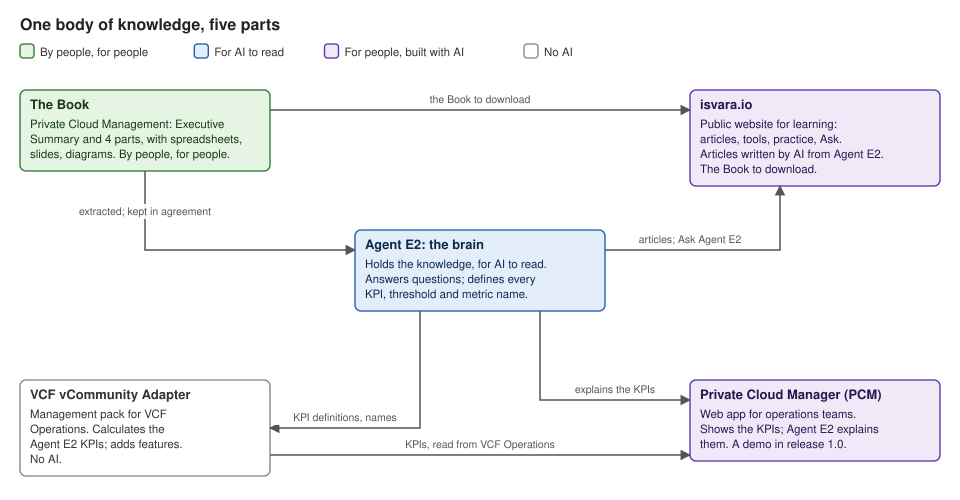

# Private Cloud Workspace

The parent repository of four repositories that are built and tested as one integrated set. It holds what no single repository can: the specification of the whole product, how the parts fit, the contracts between them, the roadmap, and the code that checks the contracts.

## The repositories

| Repository | What it is | Owns |
|---|---|---|
| [agent-e2](https://github.com/e1-rahabok/agent-e2) | The knowledge service. No UI. Answers like a VMware expert, over HTTP. | All domain knowledge: KPI definitions, thresholds, flows, explanations |
| [PCM-Adapter](https://github.com/e1-rahabok/PCM-Adapter) | The VCF vCommunity Adapter, a VCF Operations management pack. Computes the KPIs inside VCF Operations. | The KPIs Agent E2 defines; the objects and metrics it needs |
| [private-cloud-manager](https://github.com/e1-rahabok/private-cloud-manager) | PCM, a private web app for operations roles. Runs in the lab.    | Screens, roles, data connections, actions |
| [isvara](https://github.com/e1-rahabok/isvara) | isvara.io, a public web app for learning the domain. Private repository. | Public reading and vCommunity feedback, the Book to download, tools and exam pages |

PCM and isvara.io are two web apps. Both get their knowledge from Agent E2. The [system design](spec/design/system.md) has the whole picture.

## The parts and their audiences

The Book, Agent E2, isvara.io, PCM and the adapter carry the same knowledge, for the same audience, in different forms. The Book is for people to read. Agent E2 holds the knowledge for AI. isvara.io teaches it, PCM applies it to a live private cloud, and the adapter computes its KPIs inside VCF Operations.



<details>
<summary>Text of the diagram, for readers that cannot see it</summary>

Colour key: green = By people, for people; blue = For AI to read; purple = For people, built with AI; white = No AI.

Boxes, nested as drawn:
- n1 **The Book** (By people, for people): Private Cloud Management, 4 parts, with spreadsheets, slides, diagrams. Curated by people, for people.
- n2 **isvara.io** (For people, built with AI): Public website for learning: articles, tools, practice, Ask. Articles written by AI from Agent E2. The Book to download.
- n3 **Agent E2: the brain** (For AI to read): Holds the knowledge, for AI to read. Answers questions; defines every KPI, threshold and metric name.
- n4 **VCF vCommunity Adapter** (No AI): Management pack for VCF Operations 9.1. Calculates the Agent E2 KPIs; adds features. No AI.
- n5 **Private Cloud Manager (PCM)** (For people, built with AI): Web app for operations teams. Shows the KPIs; Agent E2 explains them. A demo in release 1.0.

Arrows (from, to, label):
- n1 The Book --> n2 isvara.io: the Book to download
- n1 The Book --> n3 Agent E2: the brain: extracted; kept in agreement
- n3 Agent E2: the brain --> n2 isvara.io: articles; Ask Agent E2
- n3 Agent E2: the brain --> n4 VCF vCommunity Adapter: KPI definitions, names
- n3 Agent E2: the brain --> n5 Private Cloud Manager (PCM): explains the KPIs
- n4 VCF vCommunity Adapter --> n5 Private Cloud Manager (PCM): KPIs, read from VCF Operations

Arrows: `-->` solid, `..>` dashed.

</details>

## The files here

| File | Holds |
|---|---|
| [ROADMAP.md](ROADMAP.md) | The plan on one page: milestones in order, and what each needs |
| [OPEN-QUESTIONS.md](OPEN-QUESTIONS.md) | The input still needed from the author |
| [spec/README.md](spec/README.md) | How the specification works: the chain, who writes what, the IDs |
| [spec/brief.md](spec/brief.md) | Goals, users, scope, principles, constraints, assumptions, risks, dependencies |
| [spec/requirements/](spec/requirements) | Requirements on the contracts; each repository keeps its own |
| [spec/design/system.md](spec/design/system.md) | Parts, contracts C1 to C5, quality attributes, design choices |
| [spec/test-plan.md](spec/test-plan.md) | Test levels, environments, data, criteria, traceability |
| [spec/author-input/](spec/author-input) | The author's answers, word for word |
| [`checks/`](checks) | The cross-repo checks |
| [`tools/`](tools) | Checks of the specification and the documents; the diagram tool |
| [CLAUDE.md](CLAUDE.md) | Claude's method, the same file in every repository |
| [CLAUDE-PROJECT.md](CLAUDE-PROJECT.md) | This project's rules, tools and paths, loaded by CLAUDE.md |
| [`tutorial/`](tutorial) | How this workspace is built with AI, written to teach the method to others |

## Run the checks

Clone the repositories next to this one, or let the script clone what is missing:

```powershell
uv run checks/run_all.py
```

Without uv: `pip install pyyaml requests`, then `python checks/run_all.py`. Add `--pull` to update the clones first. To test a branch of a child repository before merging it, check that branch out in its clone and run without `--pull`.

GitHub Actions runs the same checks on every push and pull request here, every day, and on demand ([checks workflow](.github/workflows/checks.yml)).
