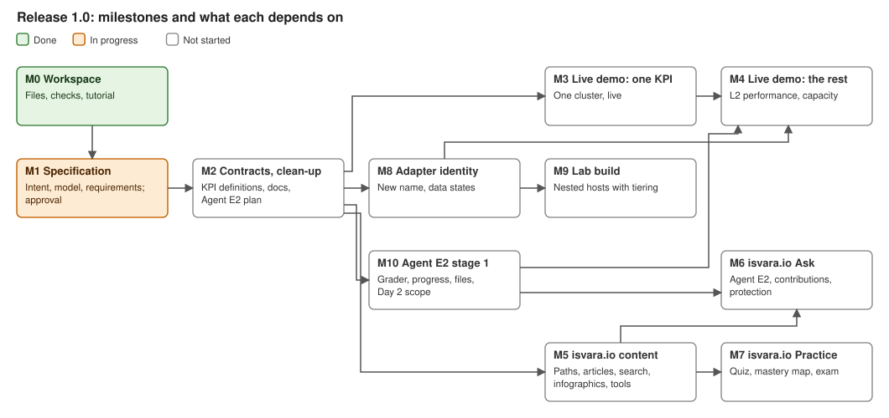

# Roadmap

The whole plan on one page: where the product is going, what release 1.0 holds, the milestones in order, and what waits for the author. Every line links to its detail. IDs are explained in the [glossary](spec/glossary.md).

## Goal

VMware administrators have the author's knowledge inside their own private cloud, and isvara.io is recognised worldwide as the authority on large-scale private cloud performance and capacity management. The test: a customer gets value without the author ([intent and principles](spec/brief.md)).

## Release 1.0

What release 1.0 holds and why is in the [brief](spec/brief.md): its goals and success (GOAL-4, GOAL-5), its scope (SCOPE-1 to SCOPE-11) and what waits until after it (SCOPE-12 to SCOPE-19). How it is built is in the [system design](spec/design/system.md), and how it is proven in the [test plan](spec/test-plan.md). isvara.io's rebuild comes first and is most of the work (M4 to M7); PCM's live demo comes last (M8), because it needs the lab.

Text of the diagram, for readers that cannot see it

Colour key: green = Done; orange = In progress; white = Not started.

Boxes, nested as drawn:
- n1 **Claude's method** (Done): Rules, gate, hook; done before the milestones
- n2 **M1 Release 1.0 specified** (Done): Every requirement, isvara.io design; no code
- n3 **M2 Contracts, clean-up** (In progress): Checks in every repository; names, PCM folders
- n4 **M3 Agent E2 for both** (Not started): Jobs, files, sources, grader, Day 2 only
- n5 **M8 PCM live demo** (Not started): Adapter fixes, live L2; every lab test
- n6 **M4 isvara.io reading** (Not started): Export, articles, paths, search, infographics
- n7 **M5 isvara.io Ask** (Not started): Agent E2, contributions, protection
- n8 **M7 isvara.io switch-over** (Not started): Home, What's New, manual; old links redirected
- n9 **M6 isvara.io practice** (Not started): Quiz, exam, daily question; catalog calculators

Arrows (from, to, label):
- n1 Claude's method --> n2 M1 Release 1.0 specified
- n2 M1 Release 1.0 specified --> n3 M2 Contracts, clean-up
- n3 M2 Contracts, clean-up --> n4 M3 Agent E2 for both
- n4 M3 Agent E2 for both --> n5 M8 PCM live demo
- n3 M2 Contracts, clean-up --> n6 M4 isvara.io reading
- n4 M3 Agent E2 for both --> n7 M5 isvara.io Ask
- n6 M4 isvara.io reading --> n7 M5 isvara.io Ask
- n7 M5 isvara.io Ask --> n8 M7 isvara.io switch-over
- n6 M4 isvara.io reading --> n9 M6 isvara.io practice
- n9 M6 isvara.io practice --> n8 M7 isvara.io switch-over

Arrows: `-->` solid, `..>` dashed.

## Rules of the milestones

- The milestones are numbered from M1 in the order of work . One is open at a time: the first whose heading does not end with ": done".
- [tools/milestone_gate.py](tools/milestone_gate.py) shows the open milestone and its next item at every prompt. It fails a pull request that changes a file owned only by a later milestone, and fails when two milestones own one file or the numbers do not run M1, M2, M3 in order.
- Each requirement belongs to exactly one milestone, or to the list after release 1.0. [tools/milestone_review.py](tools/milestone_review.py) fails otherwise, and writes one review page per milestone from the requirement files.
- A build milestone is done when every test scenario of its requirements passes ([tools/spec_check.py](tools/spec_check.py) checks that each requirement has one). Every test scenario that needs the lab sits in M8, the only milestone that runs in the lab; the review tool fails otherwise. Before M8, a check that needs the lab, such as the adapter's live validation after a code change, is reported as not run and listed in the pull request, and the line of work goes on ([test plan](spec/test-plan.md), section Environments). M8's lab session runs every listed check.
- When a milestone opens, its first pull request writes its work items, one `- [ ]` line each, so the gate shows the next one.
- The author approves each milestone. For M1 only, the author delegated the approval to Claude's self-review, and reviews M1 afterwards.

## Done before the milestones

Claude's working method, about how Claude works and never about the product, approved by the author on 2026-11-27:

- One rule for the order of work, its prompt hook and its CI check ([#35](https://github.com/e1-rahabok/private-cloud-workspace/pull/35)).
- CLAUDE.md pruned: one rule per bullet, no rule twice, the method apart from this project's rules ([#36](https://github.com/e1-rahabok/private-cloud-workspace/pull/36)).
- CLAUDE.md holds only the method, for any project; this project's rules, tools and paths are in CLAUDE-PROJECT.md, which CLAUDE.md loads ([#37](https://github.com/e1-rahabok/private-cloud-workspace/pull/37)).
- The same CLAUDE.md in each child repository, each with its own CLAUDE-PROJECT.md: agent-e2 ([#475](https://github.com/e1-rahabok/agent-e2/pull/475)), PCM-Adapter ([#105](https://github.com/e1-rahabok/PCM-Adapter/pull/105)), private-cloud-manager ([#75](https://github.com/e1-rahabok/private-cloud-manager/pull/75)), isvara ([#2](https://github.com/e1-rahabok/isvara/pull/2)).
- A check that every copy of CLAUDE.md equals the workspace's, [tools/claude_md_copies.py](tools/claude_md_copies.py), run in CI for all but isvara ([#39](https://github.com/e1-rahabok/private-cloud-workspace/pull/39)).
- The workspace files, the contract checks C1 and C3, the stop rules, the diagram tool, the writing rules and their check, and the tutorial's first version ([#1](https://github.com/e1-rahabok/private-cloud-workspace/pull/1), [#2](https://github.com/e1-rahabok/private-cloud-workspace/pull/2), [#3](https://github.com/e1-rahabok/private-cloud-workspace/pull/3), [#6](https://github.com/e1-rahabok/private-cloud-workspace/pull/6), [#7](https://github.com/e1-rahabok/private-cloud-workspace/pull/7)). M1 reviews them against the decisions.

## Milestones

### M1 Release 1.0 specified: done

- **Outcome:** every requirement of release 1.0 is written, testable, free of contradictions and kept in the repository that implements it, and every later milestone has its review page. No code is written in M1.
- **Runs:** in a cloud session; documents only.
- **The author:** delegated the approval to Claude's self-review; reviews M1 on return and can reopen it.
- Files in this repository: [`ROADMAP.md`](ROADMAP.md), [`OPEN-QUESTIONS.md`](OPEN-QUESTIONS.md), [`README.md`](README.md), [`spec/`](spec), [`images/`](images), [`tools/milestone_gate.py`](tools/milestone_gate.py), [`tools/milestone_review.py`](tools/milestone_review.py), [`tools/spec_check.py`](tools/spec_check.py), [`tools/diagrams.py`](tools/diagrams.py), [`tools/docs.py`](tools/docs.py), [`tools/requirement_files.py`](tools/requirement_files.py), [`.github/`](.github).

- [x] The milestones revamped: M1 to M8, one outcome each, no file or requirement in two milestones, both checked by code ([#40](https://github.com/e1-rahabok/private-cloud-workspace/pull/40), [agent-e2#476](https://github.com/e1-rahabok/agent-e2/pull/476)).
- [x] The foundations reviewed against the decisions: SYSTEM.md, CONTRACTS.md, README.md, the glossary and the tutorial's method chapters ([#41](https://github.com/e1-rahabok/private-cloud-workspace/pull/41)).
- [x] Every requirement in the repository that implements it (DESIGN-4); the workspace keeps the contracts and their checks, and its tools read the requirements of every repository ([#42](https://github.com/e1-rahabok/private-cloud-workspace/pull/42), [agent-e2#477](https://github.com/e1-rahabok/agent-e2/pull/477), [PCM-Adapter#106](https://github.com/e1-rahabok/PCM-Adapter/pull/106), [private-cloud-manager#76](https://github.com/e1-rahabok/private-cloud-manager/pull/76), [isvara#3](https://github.com/e1-rahabok/isvara/pull/3)).
- [x] Every contradiction between two requirement files fixed, each listed in its pull request ([agent-e2#478](https://github.com/e1-rahabok/agent-e2/pull/478), [PCM-Adapter#107](https://github.com/e1-rahabok/PCM-Adapter/pull/107), [private-cloud-manager#77](https://github.com/e1-rahabok/private-cloud-manager/pull/77), [isvara#4](https://github.com/e1-rahabok/isvara/pull/4), [#43](https://github.com/e1-rahabok/private-cloud-workspace/pull/43)).
- [x] Agent E2's requirements updated for the Day 2 scope (SCOPE-2) and the round 2 decisions; the parts that need live lab facts moved to M8 ([agent-e2#478](https://github.com/e1-rahabok/agent-e2/pull/478), [PCM-Adapter#107](https://github.com/e1-rahabok/PCM-Adapter/pull/107), [private-cloud-manager#77](https://github.com/e1-rahabok/private-cloud-manager/pull/77), [isvara#4](https://github.com/e1-rahabok/isvara/pull/4), [#43](https://github.com/e1-rahabok/private-cloud-workspace/pull/43)).
- [x] Requirements on the callers of Agent E2 moved to the callers: PCM's to M8, isvara.io's to M5 ([agent-e2#479](https://github.com/e1-rahabok/agent-e2/pull/479), [private-cloud-manager#78](https://github.com/e1-rahabok/private-cloud-manager/pull/78), [isvara#5](https://github.com/e1-rahabok/isvara/pull/5), [#44](https://github.com/e1-rahabok/private-cloud-workspace/pull/44)).
- [x] The live demo's requirements updated for the round 2 decisions ([agent-e2#478](https://github.com/e1-rahabok/agent-e2/pull/478), [PCM-Adapter#107](https://github.com/e1-rahabok/PCM-Adapter/pull/107), [private-cloud-manager#77](https://github.com/e1-rahabok/private-cloud-manager/pull/77), [isvara#4](https://github.com/e1-rahabok/isvara/pull/4), [#43](https://github.com/e1-rahabok/private-cloud-workspace/pull/43)).
- [x] Every test scenario that needs the lab in M8; M2 and M3 keep the scenarios that run anywhere, and the review tool checks it ([agent-e2#478](https://github.com/e1-rahabok/agent-e2/pull/478), [PCM-Adapter#107](https://github.com/e1-rahabok/PCM-Adapter/pull/107), [private-cloud-manager#77](https://github.com/e1-rahabok/private-cloud-manager/pull/77), [isvara#4](https://github.com/e1-rahabok/isvara/pull/4), [#43](https://github.com/e1-rahabok/private-cloud-workspace/pull/43)).
- [x] The exam's requirements updated for the round 2 decisions ([agent-e2#478](https://github.com/e1-rahabok/agent-e2/pull/478), [PCM-Adapter#107](https://github.com/e1-rahabok/PCM-Adapter/pull/107), [private-cloud-manager#77](https://github.com/e1-rahabok/private-cloud-manager/pull/77), [isvara#4](https://github.com/e1-rahabok/isvara/pull/4), [#43](https://github.com/e1-rahabok/private-cloud-workspace/pull/43)).
- [x] isvara.io before and after: one document, feature by feature, for the author's review before anything is built (answer to Q-WS-41) ([agent-e2#479](https://github.com/e1-rahabok/agent-e2/pull/479), [private-cloud-manager#78](https://github.com/e1-rahabok/private-cloud-manager/pull/78), [isvara#5](https://github.com/e1-rahabok/isvara/pull/5), [#44](https://github.com/e1-rahabok/private-cloud-workspace/pull/44)).
- [x] isvara.io's requirements for M4 to M7, written from that document ([agent-e2#479](https://github.com/e1-rahabok/agent-e2/pull/479), [private-cloud-manager#78](https://github.com/e1-rahabok/private-cloud-manager/pull/78), [isvara#5](https://github.com/e1-rahabok/isvara/pull/5), [#44](https://github.com/e1-rahabok/private-cloud-workspace/pull/44)).
- [x] A fresh agent reads the specification cold and finds no contradiction, no requirement that cannot be tested, and no requirement outside a milestone: three cold reads and two checks of the fixes, the last of which found one stale word, fixed ([#46](https://github.com/e1-rahabok/private-cloud-workspace/pull/46), [#47](https://github.com/e1-rahabok/private-cloud-workspace/pull/47), [#48](https://github.com/e1-rahabok/private-cloud-workspace/pull/48), [#49](https://github.com/e1-rahabok/private-cloud-workspace/pull/49), [PCM-Adapter#112](https://github.com/e1-rahabok/PCM-Adapter/pull/112)).
- [x] Approval: Claude's self-review, delegated by the author; the author reviews M1 on return and can reopen it ([#50](https://github.com/e1-rahabok/private-cloud-workspace/pull/50)).

### M2 Contracts checked and repositories cleaned: in progress

- **Outcome:** every contract that exists today is checked on every pull request of every repository, and each repository has the names and the folder layout the decisions set.
- **Needs:** M1.
- **Runs:** in a cloud session. The adapter's lab scenarios run in M8.
- Files in this repository: [`contract-checks/`](contract-checks), [`tools/file_names.py`](tools/file_names.py), [`tools/forbidden_names.py`](tools/forbidden_names.py), [`tools/test_file_names.py`](tools/test_file_names.py), [`tools/test_forbidden_names.py`](tools/test_forbidden_names.py), [`tools/lab_addresses.py`](tools/lab_addresses.py), [`tools/test_lab_addresses.py`](tools/test_lab_addresses.py), [`tools/secret_values.py`](tools/secret_values.py), [`tools/test_secret_values.py`](tools/test_secret_values.py), [`tools/workflows.py`](tools/workflows.py), [`tools/test_workflows.py`](tools/test_workflows.py), [`tools/branch_cleanup.py`](tools/branch_cleanup.py), [`tools/test_branch_cleanup.py`](tools/test_branch_cleanup.py), [`tools/style.py`](tools/style.py), [`style-baseline.yaml`](style-baseline.yaml), [`writing/`](writing).
- **Requirements:** R-WS-001 to R-WS-007, R-WS-009 to R-WS-014 and R-REPO-006 ([workspace.md](spec/requirements/workspace.md)), R-KPI-001 to R-KPI-006 ([kpi-definitions.md](spec/requirements/kpi-definitions.md)), R-ADP-005 to R-ADP-011 and R-ADP-025 ([adapter.md](https://github.com/e1-rahabok/PCM-Adapter/blob/main/spec/requirements/adapter.md)), R-REPO-001 and R-REPO-002 (PCM-Adapter's [clean-up.md](https://github.com/e1-rahabok/PCM-Adapter/blob/main/spec/requirements/clean-up.md)), R-REPO-003 and R-REPO-004 (agent-e2's [clean-up.md](https://github.com/e1-rahabok/agent-e2/blob/main/project/requirements/clean-up.md)), R-REPO-005, R-REPO-007 and R-REPO-008 (private-cloud-manager's [clean-up.md](https://github.com/e1-rahabok/private-cloud-manager/blob/main/spec/requirements/clean-up.md)), R-REPO-010 and R-REPO-011 (isvara's [clean-up.md](https://github.com/e1-rahabok/isvara/blob/main/spec/requirements/clean-up.md)), R-DEPLOY-001 to R-DEPLOY-003 (isvara's [deployment.md](https://github.com/e1-rahabok/isvara/blob/main/spec/requirements/deployment.md)).

- [x] C1, step 1: every row of Agent E2's catalog has a `key`, the adapter row's name (R-KPI-001) ([agent-e2#483](https://github.com/e1-rahabok/agent-e2/pull/483)).
- [x] C1, step 2: the KPI definitions check matches rows by key, then compares names, limits and excluded-when-green, with a planted break of each kind (R-KPI-001 to R-KPI-003) ([#52](https://github.com/e1-rahabok/private-cloud-workspace/pull/52)).
- [x] C1, step 3: the catalog's renamed rows, its Cluster Performance score row and its production Risk level, which release 1.0 applies to every cluster (DESIGN-18), with the adapter's labels and intervals to match; the check also compares intervals, score bands and closure levels, and `NAME_GAPS` and `CLOSURE_GAPS` are empty (R-KPI-005, R-KPI-006, R-ADP-006, R-ADP-008, R-ADP-010, R-ADP-011) ([agent-e2#484](https://github.com/e1-rahabok/agent-e2/pull/484), [PCM-Adapter#113](https://github.com/e1-rahabok/PCM-Adapter/pull/113), [#53](https://github.com/e1-rahabok/private-cloud-workspace/pull/53), [agent-e2#491](https://github.com/e1-rahabok/agent-e2/pull/491), [PCM-Adapter#120](https://github.com/e1-rahabok/PCM-Adapter/pull/120), [#63](https://github.com/e1-rahabok/private-cloud-workspace/pull/63)).
- [x] The adapter's declared keys equal its published keys, and its files use one name for the pack and none of the old repository names (R-ADP-005, R-ADP-007, R-ADP-025) ([PCM-Adapter#114](https://github.com/e1-rahabok/PCM-Adapter/pull/114)).
- [x] One set of writing rules, run by [tools/style.py](tools/style.py) in every repository (R-WS-006) ([#57](https://github.com/e1-rahabok/private-cloud-workspace/pull/57), [#58](https://github.com/e1-rahabok/private-cloud-workspace/pull/58), [#60](https://github.com/e1-rahabok/private-cloud-workspace/pull/60), [agent-e2#488](https://github.com/e1-rahabok/agent-e2/pull/488), [PCM-Adapter#118](https://github.com/e1-rahabok/PCM-Adapter/pull/118), [private-cloud-manager#86](https://github.com/e1-rahabok/private-cloud-manager/pull/86), [isvara#11](https://github.com/e1-rahabok/isvara/pull/11), [isvara#12](https://github.com/e1-rahabok/isvara/pull/12)).
- [x] The name check and the forbidden names check, run by [contract-checks/run_all.py](contract-checks/run_all.py) (R-WS-007, R-REPO-006; T-REPO-007b and T-REPO-008e in PCM's [clean-up.md](https://github.com/e1-rahabok/private-cloud-manager/blob/main/spec/requirements/clean-up.md)) ([#56](https://github.com/e1-rahabok/private-cloud-workspace/pull/56), [private-cloud-manager#85](https://github.com/e1-rahabok/private-cloud-manager/pull/85)).
- [x] Every contract names its check, and the cross-repo checks run on the pull requests of every child repository, isvara's in its own CI (R-WS-001, R-WS-002) ([#54](https://github.com/e1-rahabok/private-cloud-workspace/pull/54), [isvara#10](https://github.com/e1-rahabok/isvara/pull/10), [private-cloud-manager#84](https://github.com/e1-rahabok/private-cloud-manager/pull/84), [agent-e2#486](https://github.com/e1-rahabok/agent-e2/pull/486), [PCM-Adapter#115](https://github.com/e1-rahabok/PCM-Adapter/pull/115)).
- [x] R-WS-003 to R-WS-005 hold on every pull request of M2. Every merged M2 pull request passed its checks; the four child pull requests merged before their repositories ran the shared workflow ([agent-e2#483](https://github.com/e1-rahabok/agent-e2/pull/483) to [agent-e2#485](https://github.com/e1-rahabok/agent-e2/pull/485), [private-cloud-manager#83](https://github.com/e1-rahabok/private-cloud-manager/pull/83)) were read by every later workspace run of [tools/spec_check.py](tools/spec_check.py). A fresh reviewer read every Markdown line added in M2 for IDs without their meaning (T-WS-005a) and found 4; each is fixed ([agent-e2#493](https://github.com/e1-rahabok/agent-e2/pull/493), [isvara#15](https://github.com/e1-rahabok/isvara/pull/15), and this repository's tutorial chapters 7 and 9). The glossary gains the Q-PCM-, Q-ADP- and Q-ISVARA- prefixes. A second fresh reviewer read every M2 pull request from [#67](https://github.com/e1-rahabok/private-cloud-workspace/pull/67) on, in all five repositories, on 2026-11-28 and found 12 more; each is fixed ([agent-e2#501](https://github.com/e1-rahabok/agent-e2/pull/501), [PCM-Adapter#129](https://github.com/e1-rahabok/PCM-Adapter/pull/129), [private-cloud-manager#96](https://github.com/e1-rahabok/private-cloud-manager/pull/96), [isvara#28](https://github.com/e1-rahabok/isvara/pull/28), [#86](https://github.com/e1-rahabok/private-cloud-workspace/pull/86)). A third read this round's pull requests and the security round's ([#82](https://github.com/e1-rahabok/private-cloud-workspace/pull/82), [#83](https://github.com/e1-rahabok/private-cloud-workspace/pull/83) and their child pull requests) and found 10, five of them OWASP codes; each is fixed in this round's pull requests.
- [x] Agent E2's plan describes release 1.0, and the older benchmarks are removed (R-REPO-003, R-REPO-004) ([agent-e2#485](https://github.com/e1-rahabok/agent-e2/pull/485)).
- [x] The adapter's documentation keeps only what the adapter does (R-REPO-001, R-REPO-002) ([agent-e2#487](https://github.com/e1-rahabok/agent-e2/pull/487), [PCM-Adapter#116](https://github.com/e1-rahabok/PCM-Adapter/pull/116)).
- [x] PCM is named Private Cloud Manager (R-REPO-005): each remaining use of "Private Cloud Management" names the discipline or a book (T-REPO-005a, 2026-11-28) ([private-cloud-manager#83](https://github.com/e1-rahabok/private-cloud-manager/pull/83)).
- [x] PCM's files are named for what they hold, and its folders are grouped by workspace (R-REPO-007, R-REPO-008) ([private-cloud-manager#83](https://github.com/e1-rahabok/private-cloud-manager/pull/83), [private-cloud-manager#84](https://github.com/e1-rahabok/private-cloud-manager/pull/84), [#55](https://github.com/e1-rahabok/private-cloud-workspace/pull/55)). On 2026-11-28 PCM's 153 unit tests and all its page tests passed, L2's LPG-20 included, and the demo started (T-REPO-007a, T-REPO-008a); C3 and the forbidden names check passed (T-REPO-007b, T-REPO-008d, T-REPO-008e); no file that only L2 uses sits outside L2's folder (T-REPO-008b). After the author's answer to Q-PCM-4 ([round 6](spec/author-input/interview-round-6.md)), the Docs workspace's folder is [`pcm/docs_workspace`](https://github.com/e1-rahabok/private-cloud-manager/tree/main/pcm/docs_workspace), and no folder under [`pcm/`](https://github.com/e1-rahabok/private-cloud-manager/tree/main/pcm) is named with a glossary or contract term for something it does not hold (T-REPO-008f) ([private-cloud-manager#101](https://github.com/e1-rahabok/private-cloud-manager/pull/101)). A fresh session ran T-WS-007b on PCM again on 2026-11-28 and found no wrong guess (T-REPO-007c, T-REPO-008c); its five partial guesses, and why each name stays, are in [private-cloud-manager#101](https://github.com/e1-rahabok/private-cloud-manager/pull/101).
- [x] A fresh session guesses each repository's folders from the tree alone, and every wrong guess is renamed ([T-WS-007b](spec/requirements/workspace.md)). The review ran and three folders were renamed ([PCM-Adapter#117](https://github.com/e1-rahabok/PCM-Adapter/pull/117)). PCM's Docs workspace folder is now [`pcm/docs_workspace`](https://github.com/e1-rahabok/private-cloud-manager/tree/main/pcm/docs_workspace) (Q-PCM-2 and Q-PCM-4, [round 6](spec/author-input/interview-round-6.md); [private-cloud-manager#89](https://github.com/e1-rahabok/private-cloud-manager/pull/89), [private-cloud-manager#101](https://github.com/e1-rahabok/private-cloud-manager/pull/101)). isvara's layout is designed and moved in M2, in the line below (DESIGN-6). agent-e2's [`knowledge/sp5-framework/`](https://github.com/e1-rahabok/agent-e2/tree/main/knowledge/sp5-framework) keeps its name (Q-E2-273 in agent-e2's [author-questions-resolved.md](https://github.com/e1-rahabok/agent-e2/blob/main/project/author-questions-resolved.md), [agent-e2#492](https://github.com/e1-rahabok/agent-e2/pull/492)). A fresh session ran it again on the workspace and on PCM on 2026-11-28. In the workspace it took `checks/` for every check while [`tools/`](tools) held checks too: the contracts' checks moved to [`contract-checks/`](contract-checks) and the rest to [`tools/`](tools) (DESIGN-5). It found isvara.io's plan, its before and after, and the lab build's requirements here: DESIGN-4 says when each moves, and M4 moves the first two. In PCM it took the Docs workspace's folder, then named for definitions, for the KPI definitions; the author answered Q-PCM-4, and a third run on PCM, after the rename, found no wrong guess ([private-cloud-manager#101](https://github.com/e1-rahabok/private-cloud-manager/pull/101)). It expected PCM's [`tools/lab`](https://github.com/e1-rahabok/private-cloud-manager/tree/main/tools/lab) to hold the lab tests; PCM's [CLAUDE-PROJECT.md](https://github.com/e1-rahabok/private-cloud-manager/blob/main/CLAUDE-PROJECT.md) now says they are written in M8 ([private-cloud-manager#96](https://github.com/e1-rahabok/private-cloud-manager/pull/96), [#86](https://github.com/e1-rahabok/private-cloud-workspace/pull/86)).
- [ ] isvara's folders laid out for a reader who knows the field but not Next.js, mapped in its README and checked on every pull request; Homelabs removed; `/estate` becomes `/health-check` with a redirect (R-REPO-010, R-REPO-011; isvara's next pull request, this repository's next pull request). The same change specifies isvara.io's first visit, return and addresses to bookmark, built in M7, and replaces the text art of its visitor experience with SVG wireframes checked in CI.
- [ ] isvara.io's parallel site set up: the Vercel project `isvara-next` builds the fork's `main` at isvara-next.vercel.app, is not indexed, keeps its own stores, and takes the original's commits every week (R-DEPLOY-001 to R-DEPLOY-003, DESIGN-29; isvara's next pull request). It needs the author's Vercel team Agent ISV (`agent-isv`) connected, or the project created there by the author.
- [x] The specification set out for spec-driven development: the author's input word for word, the [brief](spec/brief.md), the [system design](spec/design/system.md) with its design choices and the options rejected, the [test plan](spec/test-plan.md), and a Why line on every workspace requirement, all checked by [tools/spec_check.py](tools/spec_check.py) (R-WS-003, DESIGN-8) ([#67](https://github.com/e1-rahabok/private-cloud-workspace/pull/67)).
- [x] Every requirement in the child repositories has a Why line and cites the brief or the system design; the decision log is retired and its outcomes live where they apply (R-WS-003, DESIGN-8) ([agent-e2#494](https://github.com/e1-rahabok/agent-e2/pull/494), [PCM-Adapter#121](https://github.com/e1-rahabok/PCM-Adapter/pull/121), [private-cloud-manager#90](https://github.com/e1-rahabok/private-cloud-manager/pull/90), [isvara#16](https://github.com/e1-rahabok/isvara/pull/16), this repository's next pull request).
- [x] The READMEs and CLAUDE-PROJECT.md files of the five repositories read against the specification, and every disagreement fixed, the specification first (R-WS-009). A fresh reviewer read the ten files on 2026-11-28 (T-WS-009a) and found 17 disagreements, listed in the pull requests: 16 are fixed, the system design's diagram first ([agent-e2#498](https://github.com/e1-rahabok/agent-e2/pull/498), [PCM-Adapter#126](https://github.com/e1-rahabok/PCM-Adapter/pull/126), [private-cloud-manager#93](https://github.com/e1-rahabok/private-cloud-manager/pull/93), [isvara#20](https://github.com/e1-rahabok/isvara/pull/20), [#76](https://github.com/e1-rahabok/private-cloud-workspace/pull/76)). The last, whether release 1.0 ships PCM as a container with VKS, went to the author as Q-WS-139: PCM runs on its lab VM in release 1.0, and the container waits until after it (SCOPE-3, SCOPE-19); this repository's next pull request.
- [x] No repository holds a lab address or host name: documents name each lab system by its role, the lab tools read `$HOME\.secrets\lab.json`, and [tools/lab_addresses.py](tools/lab_addresses.py) runs on every pull request (R-WS-010, DESIGN-9) ([agent-e2#499](https://github.com/e1-rahabok/agent-e2/pull/499), [PCM-Adapter#127](https://github.com/e1-rahabok/PCM-Adapter/pull/127), [private-cloud-manager#94](https://github.com/e1-rahabok/private-cloud-manager/pull/94), [isvara#26](https://github.com/e1-rahabok/isvara/pull/26), [#82](https://github.com/e1-rahabok/private-cloud-workspace/pull/82)).
- [x] Release 1.0 reviewed against four public security baselines, mapped in the system design's section Security baseline (DESIGN-24 to DESIGN-27); the checks for secrets, workflow rights and Dependabot, and the npm audit gate, run on every pull request (R-WS-011, R-WS-012); isvara.io's vulnerable dependencies fixed ([agent-e2#500](https://github.com/e1-rahabok/agent-e2/pull/500), [PCM-Adapter#128](https://github.com/e1-rahabok/PCM-Adapter/pull/128), [private-cloud-manager#95](https://github.com/e1-rahabok/private-cloud-manager/pull/95), [isvara#27](https://github.com/e1-rahabok/isvara/pull/27), this repository's next pull request).
- [x] Every repository runs its own tests in its CI, on every pull request and every push to main (RISK-7; the [test plan](spec/test-plan.md), section Own tests in CI): agent-e2's knowledge rules check and unit tests, PCM's unit and page tests, isvara's lint, type check, RVTools test, link gate and build, beside PCM-Adapter's existing CI. L2's page test LPG-20, which failed on main unseen, passes: PCM's L2 specification and the test now say that Agent E2's opening is Markdown (D-119, PCM's decision on that opening), and each page test owns its ports ([agent-e2#501](https://github.com/e1-rahabok/agent-e2/pull/501), [private-cloud-manager#96](https://github.com/e1-rahabok/private-cloud-manager/pull/96), [isvara#28](https://github.com/e1-rahabok/isvara/pull/28), [#86](https://github.com/e1-rahabok/private-cloud-workspace/pull/86)).
- [ ] No branch that `main` holds stays on GitHub: each repository's branch cleanup deletes every branch that is not ahead of `main`, inside GitHub with its own token, and the workflows check fails a repository without it (R-WS-014, DESIGN-28).
- [ ] Approval: the author approves M2 from its [review page](spec/review/M2.md).

### M3 Agent E2 serves PCM and isvara.io

- **Outcome:** one Agent E2 service answers both callers: long answers as jobs with a visible stage, screenshots and CSV files, sources by ID and title, time and tokens per answer, Day 2 questions only; its free-text answers are graded automatically.
- **Needs:** M2, so the contract check C3 (the Agent E2 API) runs on every pull request.
- **Runs:** in a cloud session. The graded runs need the Vercel AI Gateway key, within US$100 a run (CONSTRAINT-1).
- **The author:** gives the gateway key for this environment at the start, reviews the answer keys an independent agent marks uncertain, and grades 20 answers once (Q-WS-92). M3 is done only after these.
- **Requirements:** R-WS-008 (the C5 check, in [workspace.md](spec/requirements/workspace.md)); R-E2-001 to R-E2-019 and R-E2-021 to R-E2-025 (agent-e2's [answer-service.md](https://github.com/e1-rahabok/agent-e2/blob/main/project/requirements/answer-service.md); R-E2-009, R-E2-017 and R-E2-019 in the workspace's [agent-e2-api.md](spec/requirements/agent-e2-api.md)).

### M4 isvara.io reading

- **Outcome:** on the parallel site (DESIGN-29), a visitor reads every Agent E2 knowledge file as an article, finds it through the three learning paths and through search, and sees the first infographic. Every fact and number on an article comes from Agent E2's export; the tools follow in M6.
- **Needs:** M2 for the checks, and the author's review of the [before and after](spec/design/isvara-before-and-after.md), which the author asked for before anything is built (Q-WS-41). It does not need M3.
- **Runs:** in a cloud session. The rewrite of each article and its checks need the Vercel AI Gateway key.
- **Requirements:** R-CONTENT-002 to R-CONTENT-021 (isvara's [content.md](https://github.com/e1-rahabok/isvara/blob/main/spec/requirements/content.md)), R-JOURNEY-001 and R-JOURNEY-002 (isvara's [journeys.md](https://github.com/e1-rahabok/isvara/blob/main/spec/requirements/journeys.md)), R-E2-027 and R-E2-028 (agent-e2's [knowledge-export.md](https://github.com/e1-rahabok/agent-e2/blob/main/project/requirements/knowledge-export.md)), R-EXPORT-001 and R-EXPORT-002 (the workspace's [knowledge-export.md](spec/requirements/knowledge-export.md), contract C4); and the move of isvara.io's plan and before and after from this repository to isvara (DESIGN-4).

### M5 isvara.io Ask and contributions

- **Outcome:** on the parallel site, a visitor asks Agent E2 a question, with screenshots and CSV files, follows its progress and opens its sources; sends a contribution to a private queue; and the protection layers stop floods, bots, unsafe files and hidden instructions.
- **Needs:** M3 for the Agent E2 API, and M4 for the articles that sources open. The injection guard is decided (DESIGN-10).
- **Runs:** in a cloud session. Where the public Agent E2 runs is chosen after measuring (Q-WS-4); a new hosting account would need the author.
- **Requirements:** R-ASK-001 to R-ASK-012 ([ask.md](https://github.com/e1-rahabok/isvara/blob/main/spec/requirements/ask.md)), R-CONTRIB-001 to R-CONTRIB-009 ([contributions.md](https://github.com/e1-rahabok/isvara/blob/main/spec/requirements/contributions.md)), R-PROTECT-001 to R-PROTECT-008 ([protection.md](https://github.com/e1-rahabok/isvara/blob/main/spec/requirements/protection.md)), R-JOURNEY-003 and R-JOURNEY-006 ([journeys.md](https://github.com/e1-rahabok/isvara/blob/main/spec/requirements/journeys.md)).

### M6 isvara.io practice and tools

- **Outcome:** the quiz with its mastery map, the exam, the daily question and the 2am game's debriefs link to articles; the calculators and the RVTools health check take every number from Agent E2's catalog; the dropped tools are gone.
- **Needs:** M4 for the articles.
- **Runs:** in a cloud session. The author approves the exam's ten questions once (Q-WS-113).
- **Requirements:** R-EXAM-001 to R-EXAM-016 (isvara's [exam.md](https://github.com/e1-rahabok/isvara/blob/main/spec/requirements/exam.md)), R-CONTENT-001 (isvara's [content.md](https://github.com/e1-rahabok/isvara/blob/main/spec/requirements/content.md)), R-PRACTICE-001 to R-PRACTICE-007 ([practice.md](https://github.com/e1-rahabok/isvara/blob/main/spec/requirements/practice.md)), R-TOOL-001 to R-TOOL-007 ([tools.md](https://github.com/e1-rahabok/isvara/blob/main/spec/requirements/tools.md)), R-JOURNEY-005 and R-JOURNEY-007 ([journeys.md](https://github.com/e1-rahabok/isvara/blob/main/spec/requirements/journeys.md)).

### M7 isvara.io switched over

- **Outcome:** isvara.io serves the rebuilt site: the home page, What's New with its weekly summary, the manual for copying the product privately, downloads and the MCP endpoint on Agent E2; every old address redirects to the page that covers it.
- **Needs:** M4, M5 and M6.
- **Runs:** in a cloud session. The author approves the switch after comparing the parallel site with isvara.io side by side (CONSTRAINT-10); the fork's `main` then merges into the original's (DESIGN-29).
- **Requirements:** R-SITE-001 to R-SITE-010 ([site.md](https://github.com/e1-rahabok/isvara/blob/main/spec/requirements/site.md)), R-DEPLOY-004 ([deployment.md](https://github.com/e1-rahabok/isvara/blob/main/spec/requirements/deployment.md)), R-JOURNEY-004 and R-JOURNEY-008 ([journeys.md](https://github.com/e1-rahabok/isvara/blob/main/spec/requirements/journeys.md)); R-REPO-009 (PCM-Adapter's [clean-up.md](https://github.com/e1-rahabok/PCM-Adapter/blob/main/spec/requirements/clean-up.md)).

### M8 PCM live demo

- **Outcome:** PCM's live demo shows the lab's L2 workspace for performance and capacity, read from VCF Operations; the VCF vCommunity Adapter publishes no value built from a partial read; Agent E2 explains a real lab KPI correctly; and every test scenario of release 1.0 that needs the lab has run, with every lab check that an earlier pull request listed as not run.
- **Needs:** M2 for the catalog names, M3 for Agent E2's jobs and facts.
- **Runs:** in the lab, from the author's laptop over the VPN, with the adapter's build, install, restart and validation tools. A cloud session writes the code and the tests that run anywhere.
- **First slice:** one lab cluster's Cluster Performance on the L2 Performance tab (R-LIVE-001, R-LIVE-024, R-LIVE-030), then the rest.
- **Requirements:** R-ADP-018 to R-ADP-023 and R-ADP-026 ([adapter.md](https://github.com/e1-rahabok/PCM-Adapter/blob/main/spec/requirements/adapter.md)), R-LIVE-001 to R-LIVE-033, R-LIVE-035 to R-LIVE-040 and R-E2-020 (private-cloud-manager's [live-demo.md](https://github.com/e1-rahabok/private-cloud-manager/blob/main/spec/requirements/live-demo.md)), R-E2-026 (agent-e2's [answer-service.md](https://github.com/e1-rahabok/agent-e2/blob/main/project/requirements/answer-service.md)); the check of contract C2 (KPI metric keys).
- **Release 1.0 is done** when the author approves M8.

## Waiting for the author

What each milestone needs from the author is in the [brief](spec/brief.md), section Dependencies (DEPENDENCY-1 to DEPENDENCY-9).

## After release 1.0

The work after release 1.0, with its reasons, is in the [brief](spec/brief.md), section Out of release 1.0 (SCOPE-12 to SCOPE-19).
