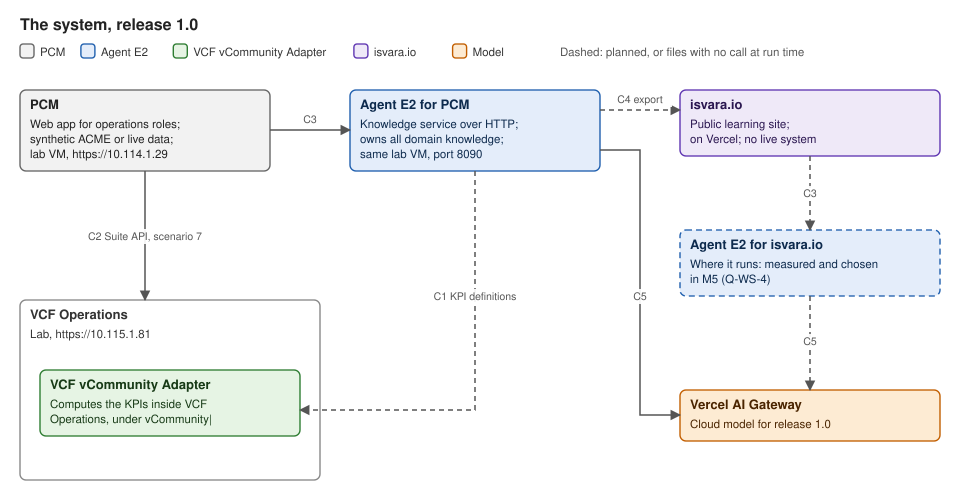

# System

How the four repositories work as one system. Current state, release 1.0. For people and for Claude.

## Two web apps, one knowledge service

Text of the diagram, for readers that cannot see it

Colour key: grey = PCM; blue = Agent E2; green = VCF vCommunity Adapter; purple = isvara.io; orange = Model.

Boxes, nested as drawn:
- n1 **PCM** (PCM): Web app for operations roles; synthetic ACME or live data; lab VM, https://10.114.1.29
- n2 **Agent E2 for PCM** (Agent E2): Knowledge service over HTTP; owns all domain knowledge; same lab VM, port 8090
- n3 **isvara.io** (isvara.io): Public learning site; on Vercel; no live system
- n4 **Agent E2 for isvara.io** (Agent E2): Where it runs: measured and chosen in M5 (Q-WS-4)
- n5 **VCF Operations**: Lab, https://10.115.1.81
  - n6 **VCF vCommunity Adapter** (VCF vCommunity Adapter): Computes the KPIs inside VCF Operations, under vCommunity|
- n7 **Vercel AI Gateway** (Model): Cloud model for release 1.0

Arrows (from, to, label):
- n1 PCM --> n2 Agent E2 for PCM: C3
- n1 PCM --> n5 VCF Operations: C2 Suite API, scenario 7
- n2 Agent E2 for PCM ..> n6 VCF vCommunity Adapter: C1 KPI definitions
- n2 Agent E2 for PCM --> n7 Vercel AI Gateway: C5
- n2 Agent E2 for PCM ..> n3 isvara.io: C4
- n3 isvara.io ..> n4 Agent E2 for isvara.io: C3
- n4 Agent E2 for isvara.io ..> n7 Vercel AI Gateway: C5

Notes on the diagram:
- Dashed: planned

Arrows: `-->` solid, `..>` dashed.

| Part | Repository | Runs where | Talks to |
|---|---|---|---|
| PCM | private-cloud-manager | Lab Linux VM moltbot29, https://10.114.1.29 (VPN) | Agent E2 over HTTP; VCF Operations Suite API (scenario 7) |
| Agent E2 for PCM | agent-e2 | Same lab VM, port 8090, as a systemd service | Vercel AI Gateway |
| VCF vCommunity Adapter | PCM-Adapter | Inside the lab VCF Operations, https://10.115.1.81 (VPN) | vCenter, VCF Operations |
| isvara.io | isvara | Vercel, public | Agent E2 (planned, ROADMAP M5); today its own AskIO agent |
| Agent E2 for isvara.io | agent-e2 | Chosen in ROADMAP M5 after measuring start-up time and cost per answer (Q-WS-4) | Vercel AI Gateway |

## Sources of each kind of data

| Thing | Source | Used by |
|---|---|---|
| KPI definitions: names, parts, limits, bands | Agent E2's [catalog](https://github.com/e1-rahabok/agent-e2/tree/main/knowledge/catalog) | VCF vCommunity Adapter, PCM, Agent E2 |
| KPI values | VCF vCommunity Adapter, published in VCF Operations under `vCommunity\|` | PCM scenario 7, through the Suite API |
| Synthetic values | PCM's generator, [`build/pcm_proto/`](https://github.com/e1-rahabok/private-cloud-manager/tree/main/build/pcm_proto) | PCM scenarios 1 to 6 |
| Explanations and answers | Agent E2 | PCM's Agent E2 panel; isvara.io (planned) |
| Reading content | Today: the Word books. Planned: the Agent E2 knowledge base | isvara.io |

## PCM demo scenarios

PCM is a web application that runs in a browser. In release 1.0 all of PCM is a demo. The demo control at the top of every page lists the demo scenarios, one per role:

1. CIO
2. NOC wall
3. NOC L1 engineer
4. L2 platform engineer
5. Capacity planner
6. Docs reader (auditor)

- **Scenarios 1 to 6** show synthetic data: ACME, a global bank with stories written relative to now. They show Agent E2 at its best.
- **Scenario 7, added in release 1.0** (ROADMAP M8): the L2 platform engineer on the author's lab VCF Operations, with live data. It proves PCM reads real data. It is still a demo, and the lab is too quiet to show Agent E2 well.

## PCM and the VCF vCommunity Adapter

The VCF vCommunity Adapter is the management pack installed inside VCF Operations. Its repository is [PCM-Adapter](https://github.com/e1-rahabok/PCM-Adapter). How PCM and the adapter relate, by mechanism:

- **Code:** separate repositories, built and installed separately. Neither contains code of the other.
- **Network:** PCM never connects to the adapter. PCM calls the VCF Operations Suite API, and the adapter is invisible to PCM.
- **Data:** the adapter computes KPIs and stores them in VCF Operations. Scenario 7 reads them there.
- **Dependency:** scenario 7 shows no KPI data without the adapter installed. Scenarios 1 to 6 do not need it.
- **Contract:** [C2, KPI metric keys](CONTRACTS.md), the keys the adapter publishes and PCM reads.

Describe this relation by one of these mechanisms. "Part of PCM" means the data dependency: PCM's live KPIs come from the adapter.

## Release 1.0 and the on-premises deployment

- **Release 1.0 (now, in scope):** PCM is a demo in the lab. Agent E2 uses a cloud model through Vercel AI Gateway. isvara.io is public on Vercel.
- **On-premises deployment (after release 1.0, out of scope):** a customer deploys PCM and Agent E2 on premises with a local model server. Text in the child repositories about on-premises models describes this deployment; some of it calls it stage 2. Do not build toward it now; do not remove it either.

## Lab

| Host | What | Access |
|---|---|---|
| 10.114.1.29 (moltbot29) | PCM and Agent E2 | VPN from the author's laptop. Secrets in `/etc/pcm/pcm.env` on the VM |
| 10.115.1.81 | VCF Operations 9 with the VCF vCommunity Adapter installed | VPN. Laptop credential: `$HOME\.secrets\vcf-ops-10.115.1.81.xml` (DECISIONS, WD-011) |
| 10.115.1.87 | vCenter | VPN. Laptop credential: `$HOME\.secrets\vcenter-10.115.1.87.xml` |

## Build and test per repository

| Repository | Runs anywhere | Needs the lab |
|---|---|---|
| agent-e2 | `python3 project/tools/rules_check.py` (0 problems), `python3 -m unittest harness/test_harness.py`, `python3 -m unittest benchmark/runner/test_runner.py` | The benchmark needs the gateway key |
| PCM-Adapter | `python -m pytest tests`, from `Management Pack` | `pwsh tools/build/build.ps1`, `install.ps1`, `restart.ps1`, `validate.ps1` (Windows, PowerShell 7, the lab) |
| private-cloud-manager | Unit tests in [`build/tests`](https://github.com/e1-rahabok/private-cloud-manager/tree/main/build/tests); page tests need Playwright ([build/README.md](https://github.com/e1-rahabok/private-cloud-manager/blob/main/build/README.md)) | Install on the lab VM: [deploy/README.md](https://github.com/e1-rahabok/private-cloud-manager/blob/main/deploy/README.md) |
| isvara | `npm run lint`, `npm run typecheck`, `npm run build`, `npm run test:rvtools` | `npm run eval` and `eval:injection` need a running server and the gateway key |
| All four together | `uv run checks/run_all.py` (this repository) | |
