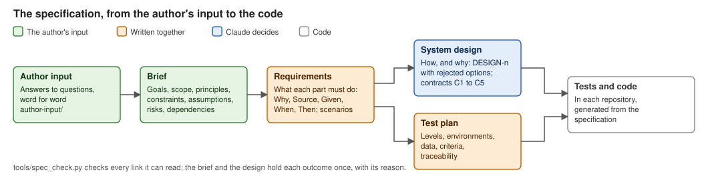

# Specification

What the product must do, how it is built, and how each part is proven, written before the code and kept true after it. The author gives the input as the domain expert and the user; Claude turns it into requirements, owns the design, and writes the tests; the two write the risks, dependencies, acceptance criteria and glossary together. The plan on one page is [ROADMAP.md](../ROADMAP.md). IDs are explained in the [glossary](glossary.md).

Text of the diagram, for readers that cannot see it

Colour key: green = The author's input; orange = Written together; blue = Claude decides; white = Code.

Boxes, nested as drawn:
- n1 **System design** (Claude decides): How, and why: DESIGN-n with rejected options; contracts C1 to C5
- n2 **Author input** (The author's input): Answers to questions, word for word author-input/
- n3 **Brief** (The author's input): Goals, scope, principles, constraints, assumptions, risks, dependencies
- n4 **Requirements** (Written together): What each part must do: Why, Source, Given, When, Then; scenarios
- n5 **Tests and code** (Code): In each repository, generated from the specification
- n6 **Test plan** (Written together): Levels, environments, data, criteria, traceability

Arrows (from, to, label):
- n2 Author input --> n3 Brief
- n3 Brief --> n4 Requirements
- n4 Requirements --> n1 System design
- n4 Requirements --> n6 Test plan
- n1 System design --> n5 Tests and code
- n6 Test plan --> n5 Tests and code

Notes on the diagram:
- tools/spec_check.py checks every link it can read; the brief and the design hold each outcome once, with its reason.

Arrows: `-->` solid, `..>` dashed.

## Files

| File | Holds | Written by |
|---|---|---|
| [author-input/](author-input) | The author's answers to questions, word for word | The author |
| [brief.md](brief.md) | Goals, users, scope, principles, constraints, assumptions, risks, dependencies | The author's input; risks and dependencies together |
| [requirements/](requirements) | What each part must do, with Why, Source, acceptance criteria and test scenarios | Together |
| [design/system.md](design/system.md) | Parts, data flow, contracts C1 to C5, quality attributes, design choices | Claude |
| [design/](design) | Designs of one feature or model: the knowledge model, the isvara.io plan | Claude |
| [test-plan.md](test-plan.md) | Test levels, environments, data, criteria, traceability, known gaps | Together |
| [glossary.md](glossary.md) | Every ID, prefix and short name | Together |
| [review/](review) | One page per milestone, for the author's approval | Generated |

- The workspace specifies only where the repositories meet (DESIGN-4). Each repository keeps its own requirements, design notes and tests, in the folder [tools/requirement_files.py](../tools/requirement_files.py) names, and the tools read them all.
- [OPEN-QUESTIONS.md](../OPEN-QUESTIONS.md) holds the input still needed from the author.

## From an answer to the code

1. Claude asks the author only for input: a goal, a scope, a requirement, an assumption, a constraint, a reason, or a fact from the field. A design question is Claude's to decide.
2. The answer is kept word for word in [author-input/](author-input).
3. Its outcome goes once into the place it changes: a brief item or a requirement, with its reason on the same line. A design choice that follows goes into the [system design](design/system.md), with the options rejected.
4. Each requirement gets acceptance criteria (Given, When, Then) and at least one test scenario.
5. The tests and the code follow, in the repository that implements the requirement.
6. A later answer changes the item in place; git keeps the history. There is no separate decision log (DESIGN-8).

## IDs

| Prefix | Item | Kept in |
|---|---|---|
| Q-WS- | A question to the author, with the answer | [author-input/](author-input), [OPEN-QUESTIONS.md](../OPEN-QUESTIONS.md) |
| GOAL-, SCOPE-, PRINCIPLE- | A goal, a scope item, a principle | [brief.md](brief.md) |
| CONSTRAINT-, ASSUMPTION- | A constraint, an assumption with its status | [brief.md](brief.md) |
| RISK-, DEPENDENCY- | A risk, a dependency | [brief.md](brief.md) |
| R-AREA-nnn, T-AREA-nnnx | A requirement, a test scenario | [requirements/](requirements), each repository's own |
| DESIGN- | A design choice | [design/system.md](design/system.md) |
| C1 to C5 | A contract between two repositories | [design/system.md](design/system.md), section Contracts |

## Checks

- `python tools/spec_check.py` prints the totals and fails when a requirement has no Why, no Source, a Source naming no existing ID, or no test scenario; when a scenario has no requirement; when a brief item or design choice is duplicated, has no reason, or names an ID that does not exist; and when a contract names no check (DESIGN-8).
- `python tools/milestone_review.py --check` fails when a requirement belongs to no milestone or to two, when a review page carries a test count, an ID or a missing section, and keeps the [review](review) pages current.
- What each check covers, and what no check covers yet: [test plan](test-plan.md), sections Traceability and Known gaps.

## Status

| File | Milestone |
|---|---|
| [workspace.md](requirements/workspace.md) | M2; R-WS-008 in M3 |
| [kpi-definitions.md](requirements/kpi-definitions.md) | M2 (001 to 006; 004 dropped) |
| [agent-e2-api.md](requirements/agent-e2-api.md) | M3 |
| [lab-build.md](requirements/lab-build.md) | After release 1.0 (SCOPE-17) |
| agent-e2's [answer-service.md](https://github.com/e1-rahabok/agent-e2/blob/main/project/requirements/answer-service.md) | M3; R-E2-026 in M8 |
| agent-e2's [clean-up.md](https://github.com/e1-rahabok/agent-e2/blob/main/project/requirements/clean-up.md) | M2 |
| PCM-Adapter's [adapter.md](https://github.com/e1-rahabok/PCM-Adapter/blob/main/spec/requirements/adapter.md) | M2: 005 to 011, 025. M8: 018 to 023, 026. Later: 013 to 017, 024 |
| PCM-Adapter's [clean-up.md](https://github.com/e1-rahabok/PCM-Adapter/blob/main/spec/requirements/clean-up.md) | M2; R-REPO-009 in M7 |
| private-cloud-manager's [live-demo.md](https://github.com/e1-rahabok/private-cloud-manager/blob/main/spec/requirements/live-demo.md) | M8; R-LIVE-034 after release 1.0 |
| private-cloud-manager's [clean-up.md](https://github.com/e1-rahabok/private-cloud-manager/blob/main/spec/requirements/clean-up.md) | M2 |
| isvara's [exam.md](https://github.com/e1-rahabok/isvara/blob/main/spec/requirements/exam.md) | M6 |
| isvara's [content.md](https://github.com/e1-rahabok/isvara/blob/main/spec/requirements/content.md) | M4 (002 to 021), M6 (001) |
| isvara's [ask.md](https://github.com/e1-rahabok/isvara/blob/main/spec/requirements/ask.md), [contributions.md](https://github.com/e1-rahabok/isvara/blob/main/spec/requirements/contributions.md), [protection.md](https://github.com/e1-rahabok/isvara/blob/main/spec/requirements/protection.md) | M5 |
| isvara's [practice.md](https://github.com/e1-rahabok/isvara/blob/main/spec/requirements/practice.md), [tools.md](https://github.com/e1-rahabok/isvara/blob/main/spec/requirements/tools.md) | M6 |
| isvara's [site.md](https://github.com/e1-rahabok/isvara/blob/main/spec/requirements/site.md) | M7 |
| [knowledge-export.md](requirements/knowledge-export.md); agent-e2's [knowledge-export.md](https://github.com/e1-rahabok/agent-e2/blob/main/project/requirements/knowledge-export.md) | M4 |
