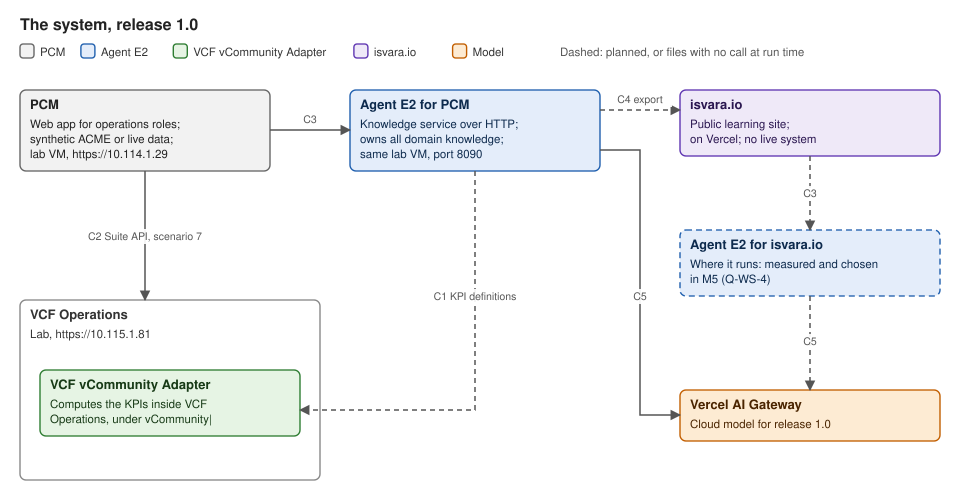

# System design

How the parts of release 1.0 are built and why: where each part runs, how data flows, the contracts between the repositories, the qualities the system must have, and the design choices that deliver them. Claude owns this design. The [brief](../brief.md) holds the author's input that bounds it, and the [requirements](../requirements) say what each part must do. A design inside one repository stays in that repository: Agent E2's [ARCHITECTURE.md](https://github.com/e1-rahabok/agent-e2/blob/main/ARCHITECTURE.md), PCM's design notes under [`pcm/`](https://github.com/e1-rahabok/private-cloud-manager/tree/main/pcm), the adapter's [development guide](https://github.com/e1-rahabok/PCM-Adapter/tree/main/docs/development-guide) and isvara's [CLAUDE-PROJECT.md](https://github.com/e1-rahabok/isvara/blob/main/CLAUDE-PROJECT.md). IDs are explained in the [glossary](../glossary.md).

## Two web apps, one knowledge service

Text of the diagram, for readers that cannot see it

Colour key: grey = PCM; blue = Agent E2; green = VCF vCommunity Adapter; purple = isvara.io; orange = Model.

Boxes, nested as drawn:
- n1 **PCM** (PCM): Web app for operations roles; synthetic ACME or live data; the lab VM
- n2 **Agent E2 for PCM** (Agent E2): Knowledge service over HTTP; owns all domain knowledge; same lab VM, port 8090
- n3 **isvara.io** (isvara.io): Public learning site; on Vercel; no live system
- n4 **Agent E2 for isvara.io** (Agent E2): Where it runs: measured and chosen in M5 (Q-WS-4)
- n5 **VCF Operations**: the lab's VCF Operations
  - n6 **VCF vCommunity Adapter** (VCF vCommunity Adapter): Computes the KPIs inside VCF Operations, under vCommunity|
- n7 **Vercel AI Gateway** (Model): Cloud model for release 1.0

Arrows (from, to, label):
- n1 PCM --> n2 Agent E2 for PCM: C3
- n1 PCM --> n5 VCF Operations: C2 Suite API, scenario 7
- n2 Agent E2 for PCM ..> n6 VCF vCommunity Adapter: C1 KPI definitions
- n2 Agent E2 for PCM --> n7 Vercel AI Gateway: C5
- n2 Agent E2 for PCM ..> n3 isvara.io: C4 export
- n3 isvara.io ..> n4 Agent E2 for isvara.io: C3
- n4 Agent E2 for isvara.io ..> n7 Vercel AI Gateway: C5

Notes on the diagram:
- Dashed: planned, or files with no call at run time

Arrows: `-->` solid, `..>` dashed.

| Part | Repository | Runs where | Talks to |
|---|---|---|---|
| PCM | private-cloud-manager | The lab VM, a Linux VM (VPN) | Agent E2 over HTTP; VCF Operations Suite API (scenario 7) |
| Agent E2 for PCM | agent-e2 | Same lab VM, port 8090, as a systemd service | Vercel AI Gateway |
| VCF vCommunity Adapter | PCM-Adapter | Inside the lab's VCF Operations (VPN) | vCenter, VCF Operations |
| isvara.io | isvara: the live site from agent-isv/isvara, the rebuild from its fork e1-rahabok/isvara | Vercel team Agent ISV (`agent-isv`), public: the live project, and the parallel project `isvara-next` (DESIGN-29) | Agent E2 (planned, ROADMAP M5); today its own AskIO agent |
| Agent E2 for isvara.io | agent-e2 | Chosen in ROADMAP M5 after measuring start-up time and cost per answer (Q-WS-4) | Vercel AI Gateway |

C1 and C4 are files, from the agent-e2 repository: the KPI definitions check compares the catalog with the adapter's code on every pull request, and isvara.io's build reads Agent E2's export. No call crosses either at run time, so the lab's Agent E2 never serves isvara.io (DESIGN-1).

## Sources of each kind of data

| Thing | Source | Used by |
|---|---|---|
| KPI definitions: names, parts, limits, bands | Agent E2's [catalog](https://github.com/e1-rahabok/agent-e2/tree/main/knowledge/catalog) | VCF vCommunity Adapter, PCM, Agent E2 |
| KPI values | VCF vCommunity Adapter, published in VCF Operations under `vCommunity\|` | PCM scenario 7, through the Suite API |
| Synthetic values | PCM's generator, [`pcm/core/generator.py`](https://github.com/e1-rahabok/private-cloud-manager/blob/main/pcm/core/generator.py) | PCM scenarios 1 to 6 |
| Explanations and answers | Agent E2 | PCM's Agent E2 panel; isvara.io (planned) |
| Reading content | Today: the Word books. Planned: the Agent E2 knowledge base | isvara.io |

## PCM demo scenarios

PCM is a web application that runs in a browser. In release 1.0 all of PCM is a demo. The demo control at the top of every page lists the demo scenarios, one per role:

1. CIO
2. NOC wall
3. NOC L1 engineer
4. L2 platform engineer
5. Capacity planner
6. Docs reader (auditor)

- **Scenarios 1 to 6** show synthetic data: ACME, a global bank with stories written relative to now. They show Agent E2 at its best.
- **Scenario 7, added in release 1.0** (ROADMAP M8): the L2 platform engineer on the author's lab VCF Operations, with live data. It proves PCM reads real data. It is still a demo, and the lab is too quiet to show Agent E2 well.

## PCM and the VCF vCommunity Adapter

The VCF vCommunity Adapter is the management pack installed inside VCF Operations. Its repository is [PCM-Adapter](https://github.com/e1-rahabok/PCM-Adapter). How PCM and the adapter relate, by mechanism:

- **Code:** separate repositories, built and installed separately. Neither contains code of the other.
- **Network:** PCM never connects to the adapter. PCM calls the VCF Operations Suite API, and the adapter is invisible to PCM.
- **Data:** the adapter computes KPIs and stores them in VCF Operations. Scenario 7 reads them there.
- **Dependency:** scenario 7 shows no KPI data without the adapter installed. Scenarios 1 to 6 do not need it.
- **Contract:** [C2, KPI metric keys](#contracts), the keys the adapter publishes and PCM reads.

Describe this relation by one of these mechanisms. "Part of PCM" means the data dependency: PCM's live KPIs come from the adapter.

## Lab

The lab's addresses and host names are in `$HOME\.secrets\lab.json` on the author's laptop and in `/etc/pcm/pcm.env` on the lab VM, and in no repository (DESIGN-9). Documents name each system by its role.

| System | What | Access |
|---|---|---|
| The lab VM | PCM and Agent E2 | VPN from the author's laptop. Secrets in `/etc/pcm/pcm.env` on the VM |
| The lab's VCF Operations | VCF Operations 9 with the VCF vCommunity Adapter installed | VPN. Laptop credentials: `$HOME\.secrets\vcf-ops-readonly.xml` and `vcf-ops-admin.xml` (DESIGN-9; Q-WS-84) |
| The lab's vCenter | vCenter | VPN. Laptop credential: `$HOME\.secrets\vcenter-readonly.xml` |

## Contracts

Every interface between two repositories. Each has one owner, its consumers, where its shape is written, and the check that proves both sides still agree (DESIGN-5). The IDs C1 to C5 are also in the [glossary](../glossary.md); the requirements per contract are in [requirements](../requirements).

| ID | Contract                     | Owner, then consumers              | Check                                                             |
| -- | ---------------------------- | ---------------------------------- | ----------------------------------------------------------------- |
| C1 | KPI definitions              | agent-e2; VCF vCommunity Adapter, PCM, isvara | [`contract-checks/kpi_definitions.py`](../../contract-checks/kpi_definitions.py), running |
| C2 | KPI metric keys              | VCF vCommunity Adapter; PCM (live demo)       | Planned in ROADMAP M8, the PCM live demo                          |
| C3 | Agent E2 API                 | agent-e2; PCM, isvara (planned)    | [`contract-checks/agent_e2_api.py`](../../contract-checks/agent_e2_api.py), running       |
| C4 | Knowledge content for isvara | agent-e2; isvara                   | `contract-checks/knowledge_export.py`, planned in ROADMAP M4          |
| C5 | Model gateway                | Vercel AI Gateway; agent-e2        | `contract-checks/model_gateway.py`, planned in ROADMAP M3                  |

### C1 KPI definitions

- **Owner:** agent-e2, [`knowledge/catalog/thresholds-performance.yaml`](https://github.com/e1-rahabok/agent-e2/blob/main/knowledge/catalog/thresholds-performance.yaml) (section `kpi`), `thresholds-risk.yaml` and `thresholds-capacity.yaml` (section `model`). One row per sub-metric: name with unit, group, direction, five limits per interval, `excluded_when_green`.
- **Implementer:** VCF vCommunity Adapter, `Management Pack/app/metrics/`: one module per KPI, a `METRICS` table of `Metric` rows (name, unit, five limits, `skip_when_green`) and a `LABELS` table that gives a row its catalog name.
- **Consumer:** PCM shows the parts under the catalog names (PCM's decisions D-113 and D-115 in [decisions.md](https://github.com/e1-rahabok/private-cloud-manager/blob/main/decisions.md)) in [`pcm/l2/spec/catalog.yaml`](https://github.com/e1-rahabok/private-cloud-manager/blob/main/pcm/l2/spec/catalog.yaml). PCM's live demo finds each part's catalog name by its key ([R-LIVE-018](https://github.com/e1-rahabok/private-cloud-manager/blob/main/spec/requirements/live-demo.md)), checked in ROADMAP M8; the synthetic demo's names in prose are not checked in release 1.0.
- **The check** matches each sub-metric by key (the catalog row's `key` against the name the adapter's KPI module gives the row), then compares the name (the adapter's label against the catalog name without its unit), the five limits, excluded-when-green and the interval, for Cluster Performance, ESXi Performance, VM Performance, Guest OS Performance, Cluster Risk and Cluster Consumption. It also compares the band table and the closure levels of the adapter's Periodic Cluster Check with the catalog's score lines and Close for Business decisions. [`contract-checks/test_kpi_definitions.py`](../../contract-checks/test_kpi_definitions.py) plants a break of each kind and expects the check to fail.
- **To change a KPI:** change Agent E2's knowledge file and catalog first, then the VCF vCommunity Adapter, in the same session, with the check run before both merges.
- **Status:** names, limits, excluded-when-green and intervals agree for every sub-metric, and the score bands and the closure levels agree with the adapter's Periodic Cluster Check. The adapter's one Cluster Risk level is compared with the catalog's production row, which release 1.0 applies to every cluster (DESIGN-18). [`contract-checks/run_all.py`](../../contract-checks/run_all.py) prints the counts.

### C2 KPI metric keys

- **Owner:** the VCF vCommunity Adapter (repository PCM-Adapter). Keys are `vCommunity|<KPI>|<sub-metric or score>`, for example `vCommunity|Cluster Performance|Cluster Performance Score`, on the vCenter objects in VCF Operations.
- **Consumer:** PCM's demo scenario 7 (live) reads them through the VCF Operations Suite API (PCM D-064, D-096). PCM never connects to the adapter itself; without the adapter installed, scenario 7 has no KPI data.
- **Check, ROADMAP M8:** PCM lists every key it reads in one structured file; the check confirms each key is one the adapter publishes, and, against the lab, that it has data.
- **Status:** no PCM connector yet.

### C3 Agent E2 API

- **Owner:** agent-e2, [`harness/answer_service.py`](https://github.com/e1-rahabok/agent-e2/blob/main/harness/answer_service.py) (its docstring is the specification). Endpoints: `POST /v1/answer`, `POST /v1/topic`, `POST /v1/suggest` (page and card), `GET /v1/health`.
- **Consumer:** PCM, [`pcm/core/agent_e2.py`](https://github.com/e1-rahabok/private-cloud-manager/blob/main/pcm/core/agent_e2.py), generated from [`pcm/core/spec/catalog/settings.yaml`](https://github.com/e1-rahabok/private-cloud-manager/blob/main/pcm/core/spec/catalog/settings.yaml) and [`pcm/l2/spec/pages/frame.md`](https://github.com/e1-rahabok/private-cloud-manager/blob/main/pcm/l2/spec/pages/frame.md).
- **The check** starts the real service in mock mode (no model, no network) and calls it with PCM's own client code. It checks every field PCM reads, by name and type, on the raw responses: PCM's client turns errors into `source: unavailable`, which would hide a broken contract.
- **Status:** running; [`contract-checks/run_all.py`](../../contract-checks/run_all.py) prints the endpoints and the differences.

### C4 Knowledge content for isvara

- Agent E2's knowledge base becomes the source of isvara.io's reading pages, replacing the Word books (DESIGN-3). Its structure is built for a model to read, so the shape of the export is design work (ROADMAP M1), built in ROADMAP M4.
- **Shape:** one schema in this workspace, `contract-checks/knowledge_export_schema.json`, that agent-e2's export and isvara.io's build both check against ([knowledge-export.md](../requirements/knowledge-export.md)).
- **Status:** not built; planned in ROADMAP M4.

### C5 Model gateway

- **Owner:** Vercel AI Gateway, an OpenAI-compatible service; Agent E2 calls it with the key `AI_GATEWAY_API_KEY`.
- **Check, ROADMAP M3:** one call to the model agent-e2 is set to, with the gateway key; without the key it reports not run ([R-WS-008](../requirements/workspace.md)). It is a third-party API, so the check proves only that the configured model answers.
- **Status:** not built.

### Changing a contract

1. **Expand:** the owner adds the new shape and keeps the old one working.
2. **Migrate:** each consumer moves to the new shape, one pull request per repository.
3. **Contract:** the owner removes the old shape.

The checks pass after every step. A pull request that breaks a check is not merged.

## Quality attributes

What each quality means for release 1.0, a demo in the lab and a public site, and the design choices below that deliver it.

| Quality | Release 1.0 target | Choices |
|---|---|---|
| Correctness | No confident wrong answer; no value built from a partial read | DESIGN-17, DESIGN-18, DESIGN-19 |
| Security and privacy | Four public baselines met; no secret or lab address in a repository; little data kept | DESIGN-9 to DESIGN-13, DESIGN-24 to DESIGN-27 |
| Performance | A live page in under 5 seconds; progress on an answer every 10 seconds | DESIGN-14, DESIGN-15 |
| Scalability | Public traffic absorbed by Vercel; answer jobs on one long-running process | DESIGN-12, DESIGN-16 |
| Availability | A demo on one lab VM, no redundancy; a failure shows as "No data" | DESIGN-15, DESIGN-17 |
| Maintainability | One master per fact; every contract checked; guessable names; traced input | DESIGN-2 to DESIGN-8 |
| Cost | US$100 a test run, nothing unchanged paid for twice; US$50 a month for isvara.io | DESIGN-16, DESIGN-20, DESIGN-31 |
| Portability | Copied privately; nothing depends on the author's services at run time | DESIGN-1, DESIGN-4 |

## Security baseline

Each item of four public baselines, and where release 1.0 meets it: [OWASP ASVS](https://owasp.org/www-project-application-security-verification-standard/) level 1, the [OWASP Top 10](https://owasp.org/Top10/), the [OWASP Top 10 for LLM applications](https://genai.owasp.org/llm-top-10/), and the [twelve-factor](https://12factor.net/config) rule on configuration (DESIGN-24). Every milestone review rereads this table against the repositories (R-WS-013).

| Baseline item | Where it is met |
|---|---|
| ASVS V2, V3; Top 10 A07: sign-in and sessions | PCM: the VPN only (ASSUMPTION-9). isvara.io's admin pages: R-PROTECT-007 |
| Top 10 A01: access control | Private contribution queue (R-CONTRIB-003); admin pages (R-PROTECT-007) |
| ASVS V5; Top 10 A03: input and injection | DESIGN-10, DESIGN-12; files checked by content (R-PROTECT-004) |
| ASVS V8: personal data | DESIGN-11, DESIGN-13; question logs kept 30 days (R-ASK-009) |
| ASVS V9: encrypted transport | TLS at nginx on the lab VM; port 8080 closed in M8 |
| ASVS V10; Top 10 A06, A08: components and integrity | DESIGN-25; R-WS-012 |
| ASVS V14; twelve-factor III: configuration and secrets | DESIGN-9, DESIGN-26; R-WS-010, R-WS-011 |
| Top 10 A05: misconfiguration | isvara.io's security headers; least rights in every workflow (R-WS-012) |
| Top 10 A09: logging and monitoring | Question log, admin digest, Vercel logs; a log never holds a secret |
| Top 10 A10: server-side request forgery | Agent E2's web lookup refuses private and non-HTTP addresses |
| LLM01: prompt injection | DESIGN-10 |
| LLM02: sensitive information | Estate names swapped before the model; DESIGN-13 |
| LLM05: output handling | Answers rendered without raw HTML; links allow-listed (R-PROTECT-008) |
| LLM06: excessive agency | Read-only tools only; no tool writes or sends |
| LLM07: system prompt leakage | Rule 4 of the prompt; the injection battery (DESIGN-10) |
| LLM10: unbounded consumption | DESIGN-20; limits per address (R-PROTECT-003) |
| Backup and recovery | DESIGN-27 |

## Design choices

Each choice is Claude's, made from the [brief](../brief.md) and the requirements. It states the choice, why, the options rejected and why, and the brief items and requirements it serves. A choice inside one repository stays in that repository's design notes; this file holds the choices that span repositories or set a quality for the whole system. A changed choice is edited in place; git keeps the history.

### Architecture

- **DESIGN-1 One knowledge service for two web apps.** PCM, private and in the lab, and isvara.io, public on Vercel, are two web apps. Both call Agent E2 over HTTP for every answer (contract C3), and Agent E2 calls its model through Vercel AI Gateway (C5). Agent E2 runs twice: on the lab VM for PCM, and as a public service for isvara.io. isvara.io connects to no live system. Agent E2 replaces AskIO on isvara.io.
  - Why: both apps give the same answer from the same knowledge (PRINCIPLE-5), and a fix to Agent E2 reaches both.
  - Rejected: (a) keep AskIO on isvara.io, which loads the books into its prompt: two answer engines drift apart, and the books would stay a second master. (b) One Agent E2 for both apps: the lab VM is behind a VPN, so the public site cannot reach it, and a public endpoint on it would expose the lab. (c) Agent E2 as a library inside each app: two copies to keep in step, in Python and in TypeScript.
  - Serves: SCOPE-1, SCOPE-8, PRINCIPLE-5; R-ASK-001, R-E2-015.
- **DESIGN-2 Domain knowledge has one master, in Agent E2.** Agent E2 holds every KPI name, part, limit, scoring rule, threshold, flow and explanation, in its knowledge files and catalog. The VCF vCommunity Adapter implements the KPIs; PCM and isvara.io consume them; isvara.io holds no knowledge of its own. A change to domain knowledge starts in agent-e2, and the adapter follows in the same session.
  - Why: with one master, every other copy is generated from it or checked against it (contract C1).
  - Rejected: (a) the adapter as master of the KPIs, since it computes them: its Python tables hold no explanation, and Agent E2 could not explain a number it does not own. (b) A copy per app: the copies drift (RISK-6).
  - Serves: PRINCIPLE-5, Q-WS-15, Q-WS-18; R-ADP-006, R-CONTENT-004, R-E2-025, R-EXAM-008, R-EXAM-009, R-EXPORT-002, R-KPI-001, R-KPI-002, R-PRACTICE-003, R-REPO-001, R-TOOL-004, R-TOOL-005.
- **DESIGN-3 isvara.io's pages built from Agent E2's knowledge.** isvara.io's articles are AI rewrites of Agent E2's knowledge files, built from an export whose shape is one schema in this workspace (contract C4). Each page passes checks before it is published. The Word books stay as downloads only.
  - Why: isvara.io then holds no copy of the knowledge that could drift (DESIGN-2).
  - Rejected: (a) keep converting the Word books into pages: a second master. (b) Show the knowledge files as they are: they are written for a model, dense and tagged, and the author asked for prose (Q-WS-42). (c) Read agent-e2's repository at run time: a page would reach readers without its checks.
  - Serves: SCOPE-8, ASSUMPTION-7; R-CONTENT-002, R-CONTENT-016, R-E2-027, R-EXPORT-002.
- **DESIGN-4 The workspace specifies where the repositories meet.** This workspace holds the brief, this design, the test plan, the contracts with their checks, and its own tools. Every other requirement, design note and test lives in the repository that implements it, and the workspace's tools read them from clones. A domain fact lives in agent-e2. A workspace requirement on a contract says that two sides are equal and names the check that compares them. "Comes from Agent E2" means that a value is stated in Agent E2 and that the implementing repository's copy equals it; nothing reads the agent-e2 repository at run time.
  - Why: a requirement next to its code changes in the same pull request as the code.
  - Rejected: (a) every requirement in the workspace: each change needs two pull requests in two repositories, and the second is forgotten. (b) Each repository on its own: nobody owns the seams. (c) The adapter reads Agent E2's catalog at run time: it runs inside VCF Operations with no access to GitHub, and a customer may install the pak without Agent E2 (SCOPE-3).
  - Two files wait here for their repository. isvara.io's [plan](isvara-plan.md) and [before and after](isvara-before-and-after.md) are isvara's design: they stay here until the author has reviewed the before and after (Q-WS-41), then move to isvara's [`spec/`](..) folder in M4. The lab build's requirements, [lab-build.md](../requirements/lab-build.md), move to the lab-build repository with its first code, after release 1.0 (SCOPE-17). A fresh reader of the tree found all three here on 2026-11-28 (T-WS-007b).
  - Serves: PRINCIPLE-5, PRINCIPLE-6; R-ADP-010, R-CONTENT-001, R-EXPORT-001, R-KPI-001, R-KPI-005, R-KPI-006.

### Maintainability

- **DESIGN-5 Every contract checked by code.** Each contract between two repositories has a check in [`contract-checks/`](../../contract-checks) that compares both sides, and a test that plants a break of each kind it compares. The checks run on every pull request of every repository, daily and on demand. Known gaps sit in a baseline that only shrinks. A contract changes in three steps: add the new shape, move each consumer, remove the old shape. The folder holds only the contracts' checks, their planted breaks and `run_all.py`, which runs them and the name checks; every other check, of names, lab addresses, secrets, workflows, words, links or the specification, is in [`tools/`](../../tools).
  - Why: without a check, the two sides of a contract drift apart and nobody notices until something breaks. The folder is named for the contracts because a fresh reader of the tree (T-WS-007b, 2026-11-28) could not tell the earlier [`contract-checks/`](../../contract-checks) from [`tools/`](../../tools): both held checks that CI runs.
  - Rejected: (a) review by reading both sides: each session starts without memory of the last, so drift passes review. (b) A shared library imported by both sides: it couples the releases of a management pack, a Python service and two web apps, and a pak inside VCF Operations cannot import from GitHub. (c) End-to-end tests only: they need the lab (CONSTRAINT-6). (d) One folder for every check: [`tools/`](../../tools) would still hold the checks of the specification, so the two names would still overlap. (e) A folder named for checks across repositories: the specification and style checks also read every repository.
  - Serves: GOAL-4, RISK-6; R-E2-009, R-E2-019, R-EXPORT-001, R-WS-001, R-WS-002, R-WS-008.
- **DESIGN-6 Names a reader can guess.** In every repository, an ID, term, heading, folder or file name can be guessed from itself. Each concept has one word, or two when one would be ambiguous. Names carry no version, milestone or status word, since git keeps the history. A name that stops being true is renamed in every file. The reader to design for knows the field but not the framework: where a framework fixes a name (Next.js's [`app/`](https://github.com/e1-rahabok/isvara/tree/main/app) and [`public/`](https://github.com/e1-rahabok/isvara/tree/main/public)), the repository's README maps every folder, and a check keeps the map true. isvara's folders were laid out in M2 by its R-REPO-010, for the rebuilt site, so M4 adds pages into the same layout.
  - Why: every session, person or AI, reads the files without memory of earlier ones, so a name that needs explaining costs every reader. The author, 2026-11-27: "The best documentation is No Documentation."
  - Rejected: (a) a naming guide with exceptions: each exception needs explaining again. (b) isvara's renames left to M4, when the rebuild moves its pages: the layout stayed undesigned until then, and the author could not read the tree (round 6, isvara.io's folders). Moving once now costs one move, since the layout is designed for the rebuilt site. (c) A reader who knows the framework, as the first fresh reads assumed: [`app/`](https://github.com/e1-rahabok/isvara/tree/main/app) and `components/` then pass, while the author, who owns the code, cannot guess them.
  - Serves: CONSTRAINT-2, CONSTRAINT-3; R-ADP-025, R-REPO-005 to R-REPO-008, R-REPO-010, R-WS-007.
- **DESIGN-7 One set of writing rules, checked by code.** Documents for people follow [writing/README.md](../../writing/README.md) and its flagged phrases; documents for machines hold one rule per bullet with exact names. [tools/style.py](../../tools/style.py) checks every repository on its pull requests, against a baseline per repository that only shrinks; agent-e2's lint reads the same list.
  - Why: the author fixed AI-speak in Agent E2 several times, and the author could not tell what a bare short name such as "C3" meant (Q-WS-46). One copy, checked by code, keeps every repository the same.
  - Rejected: (a) a copy of the rules in each repository: the copies drift. (b) Review only: the same phrases came back each time.
  - Serves: SCOPE-8, Q-WS-42, Q-WS-46; R-CONTENT-003, R-CONTENT-005, R-WS-004 to R-WS-006.
- **DESIGN-8 Traceability from the author's input to the code.** The chain runs: the author's answer, a brief item, a requirement with its Why, Source and acceptance criteria, a design choice, a test scenario, an automated test, the code. [tools/spec_check.py](../../tools/spec_check.py) checks each link it can read: every requirement has a Why line and a Source that names an existing answer, brief item or design choice; every requirement has a test scenario; every scenario belongs to a requirement; every brief item and design choice has its ID once, a reason, and only IDs that exist; every contract names its check. [tools/milestone_review.py](../../tools/milestone_review.py) checks that each requirement belongs to one milestone. The link from a scenario to its automated test is written in the scenario and not yet checked ([test plan](../test-plan.md), section Known gaps).
  - Why: each outcome lives once, where it applies, and a check finds a broken link before a reader does. It replaces the decision log, which held each outcome a second time and recorded the author's answers as decisions.
  - Rejected: (a) a decision log beside the specification: double documentation, two places that drift, and a reader who must read both. (b) A requirements tool outside git: the specification would leave the pull request that changes the code.
  - Serves: PRINCIPLE-6, GOAL-3; R-WS-003.

### Security and privacy

- **DESIGN-9 Lab credentials and addresses outside the repositories.** On the author's laptop, DPAPI files in `$HOME\.secrets\`, written by `Export-Clixml`: `vcf-ops-readonly.xml` for reading and validating, `vcf-ops-admin.xml` for installing and restarting the pack, and `vcenter-readonly.xml`. Beside them, `lab.json` holds the lab's addresses and host names (the lab VM, its SSH alias, VCF Operations, vCenter); every lab tool reads them from there. On the PCM lab VM, `/etc/pcm/pcm.env`, readable by root and group `pcm` only, holds the same addresses and the secrets. PCM signs in with the read-only account and checks the lab's certificate. No repository holds an address, a host name or a credential of the lab, the laptop or a customer: documents name a system by its role ("the lab VM"), and examples use the example network 10.20.0.0/16 and names under `example.com`. isvara.io's secrets are environment variables of its Vercel project, and the refresh workflow's Blob token is a GitHub repository secret.
  - Why: the adapter's scripts used to read an admin login from a file inside the repository folder, one wrong ignore rule away from a commit. DPAPI ties a file to one user on one machine, and a read-only account limits what a bug can do. Four of the five repositories are public: an address or host name in them maps the lab for anyone who reaches the VPN or a laptop on it, and a host name can carry a person's name. A private address is not a secret, but it is a fact about the author's network that the product does not need.
  - Rejected: (a) a file in the repository folder, ignored by git: one wrong ignore rule publishes it. (b) A different store per tool: two ways to rotate one password. (c) A secrets service: none runs in the lab, and it adds a dependency to a demo. (d) Masking part of an address (10.x.x.29): it still shows the layout, and a tool cannot use it. (e) A private repository for the lab's facts: a sixth repository to keep, for one small file. (f) Rewriting the public history to remove the addresses already committed: the addresses stay in clones, forks and pull request pages, and the rewrite breaks every link pinned to a commit, which the interview records use.
  - Serves: CONSTRAINT-6; R-WS-010, R-ADP-021, R-ADP-022, R-LAB-004, R-LIVE-007, R-LIVE-031.
- **DESIGN-10 isvara.io's injection guard before Agent E2.** isvara.io keeps its pre-scan and the fence around the visitor's turn, and adds one small model call that reads the fenced turn before Agent E2 is called and flags an instruction aimed at the assistant. A flagged question gets a fixed reply. The public Agent E2 answers only calls that carry a secret known to isvara.io, so nobody can go around the guard and the limits (Q-WS-98). Two batteries prove it: the citation eval passes when every answer to 20 reader questions lists at least one source that opens an article; the injection battery passes with 0 violations, while a one-off formatting request is still honoured. An answer is shown as Markdown without raw HTML, and its links open only isvara.io's own pages and the vendor documentation hosts on an allow-list (R-PROTECT-008), so an injected instruction cannot turn an answer into a phishing link.
  - Why: when Agent E2 answers, isvara.io no longer writes the prompt, so Rule 4 of AskIO's prompt, the layer that stops an attack today, has nowhere to live. The author placed the guard in isvara.io (Q-WS-47) and asked for the answers to be explained to readers (Q-WS-136).
  - Rejected: (a) a rule in Agent E2 that the question is data: it puts the guard in Agent E2, against Q-WS-47, and PCM's calls would pay for it. (b) The pre-scan and the fence only: more attacks get through.
  - Serves: SCOPE-8, RISK-5; R-ASK-006, R-ASK-007, R-ASK-012, R-E2-024.
- **DESIGN-11 Contributions through a private, reviewed queue.** A contribution is a correction, an addition, something to review or a question (with the sender's own answer if they have one), with a note, one link and up to three files (PNG, JPEG, CSV). Before anything is stored, a model screens its text for spam, advertising, explicit or abusive content, hidden instructions and relevance, beside the bot and file checks of DESIGN-12; a refused contribution is not kept, and when the screen cannot run, nothing is accepted. It goes to a private queue and is never published automatically; the author decides each week from an AI-sorted list, and accepted items become source notes in agent-e2. An accepted question reaches the site only as the article that answers it from the knowledge base, listed in What's New as "Asked by a reader"; the sender's own words, answer and images are never shown, and no page lets a visitor answer another visitor's question. Contributors may stay anonymous. Credit is opt-in: a name and one public profile link (LinkedIn, GitHub or the sender's own site), shown only once the author has checked the link at review. It appears on the article the contribution changed ("With thanks to"), in What's New, and on `/contributors`, an alphabetical list of each contributor's accepted items and topics with a badge to post, without ranks or points. The weekly post tags a contributor only with their consent. No company and no country are asked or shown. No email address is collected. Contributors agree, in one sentence, that they may share it, that it holds no confidential customer data, and that it may be used, changed and published. Files are deleted once processed, and after at most 30 days; no IP address is kept with a contribution. The limits are settings: 3 contributions a day per address, 3 files, 5 MB per image, 2 MB per CSV file, 2,000 characters, 1 link, and 100 contributions a day in total.
  - Why: nothing is published without review, which removes the incentive for spam; no account and no email address keep the barrier low and the personal data nil. The author asked Claude to set these details as the one who knows public websites.
  - Rejected: (a) accounts or email sign-up: a barrier for the vCommunity, and personal data to protect. (b) Publishing after an automatic check: spam and wrong knowledge reach readers. (c) Automatic masking of host names and addresses in release 1.0: unreliable on screenshots; visitors remove them (ASSUMPTION-5). (d) Readers answering readers on the site: a forum, which brings spam (one visitor can ask on one computer and post a spam answer on another), moderation work and liability (RISK-11), and adds nothing that Agent E2's knowledge does not. (e) Sending an answer to the asker privately: it needs the asker's email address, and isvara.io would still pass the answer on. (f) Storing a contribution unscreened when the screen fails: the private queue would then hold what the screen exists to keep out. (g) Showing the contributor's company: it reads as the employer's endorsement, which many employers restrict, and invites vendor marketing; the company is on the profile already. (h) A country from the IP address: wrong for administrators behind VPNs and corporate proxies, and personal data that DESIGN-11 does not keep. (i) Ranks or points for contributors: they reward volume and invite gaming, as on question-and-answer sites, and match the rule of no global board (SCOPE-9). (j) "Sign in with LinkedIn" to prove the profile is the sender's: an account, rejected in (a); a false credit can only sit on content the author approved, and the author removes it on request.
  - Serves: SCOPE-11, PRINCIPLE-3, RISK-9, RISK-11; R-ASK-003, R-CONTRIB-001 to R-CONTRIB-009, R-PROTECT-001, R-PROTECT-002, R-PROTECT-004, R-PROTECT-006.
- **DESIGN-12 isvara.io's protection layers.** One protection per threat, all in isvara.io: Vercel's platform protection and firewall rate limits against floods; an invisible bot check and a hidden field before Ask and Contribute; limits per address, 10 questions an hour and 30 a day; files checked by their content, image metadata removed, and a model call that keeps only IT screenshots; a daily ceiling on model calls (DESIGN-20); one switch that closes Ask or Contribute without a redeploy. The threats and their protections: [isvara.io plan](isvara-plan.md), section Protection. The admin pages sign in with HTTP Basic authentication over TLS, compared in constant time; a key is never part of a page's address, where browser history, server logs and the Referer header would keep it (R-PROTECT-007).
  - Why: isvara.io is public, has no sign-in, and each model call costs money.
  - Rejected: (a) sign-in before Ask: it keeps visitors out (PRINCIPLE-1). (b) A firewall product bought apart: Vercel's firewall stops floods on the current plan, which is checked before building.
  - Serves: RISK-4, RISK-5; R-PROTECT-001 to R-PROTECT-006.
- **DESIGN-13 Data the system keeps, and for how long.** PCM stores no metrics; it keeps each Agent E2 answer with its trace ID and rating for 30 days. Agent E2 keeps each answer's trace for 30 days. isvara.io keeps questions and answers with their trace and rating for 30 days, keeps no copy of the files attached to a question, and keeps a contribution's files at most 30 days, with no IP address. Lab facts may go to the cloud model. In the on-premises deployment, nothing leaves the customer's network.
  - Why: a wrong answer can be fixed only when its trace shows the cause: a missed file, a wrong file, or a file the model ignored (Q-WS-61). Thirty days covers the weekly reviews; anything kept longer is a liability (PRINCIPLE-3).
  - Rejected: (a) keep nothing: a wrong answer cannot be diagnosed. (b) Keep everything: personal and customer data with no use.
  - Serves: PRINCIPLE-3, SCOPE-5; R-ASK-009, R-CONTRIB-004, R-E2-023.

### Performance and scalability

- **DESIGN-14 Long answers as jobs with a visible stage.** A caller starts an answer as a job and reads it every 10 seconds. The job reports its stage, such as "reading files", "writing" or "checking", and a time stamp that moves at least every 10 seconds; the browser counts the time up between reads. A job that stops moving for 60 seconds shows a message, and a job ends after 10 minutes with a reason. Jobs live in the memory of one long-running Agent E2 process. A synchronous call stays for PCM's synthetic demo until it moves to jobs (SCOPE-19).
  - Why: an answer may take minutes (SCOPE-6), longer than a browser, a proxy or a serverless function waits on one request, and the user must see that Agent E2 is not hung (Q-WS-I3, Q-WS-57). Reading every 10 seconds shows progress often enough (ASSUMPTION-2) at a cost of a few small calls a minute. The longest answer measured so far took about a minute, so 10 minutes leaves margin (Q-WS-93).
  - Rejected: (a) streaming the answer: the author does not need it (Q-WS-I3), and Agent E2 checks an answer before returning it, so streamed text would reach the reader unchecked. (b) One long synchronous request: Vercel's functions and many proxies cut it. (c) Server-sent events or WebSockets: a connection held open for minutes, which the same functions and proxies cut; a plain read every 10 seconds passes any proxy.
  - Serves: SCOPE-6, ASSUMPTION-2; R-ASK-002, R-E2-007, R-E2-008, R-E2-009, R-E2-010, R-E2-020.
- **DESIGN-15 PCM reads through with a 60-second cache.** PCM's live demo reads VCF Operations through the Suite API when a page asks, keeps each response for 60 seconds, and stores nothing. A page answers in under 5 seconds; each Suite API read stops after 10 seconds; a failed read shows "No data" for the whole page (Q-WS-69).
  - Why: VCF Operations already keeps the history, so a second store would be a stale copy that needs sizing and backup. Sixty seconds is shorter than the 5-minute collection cycle, so the cache never hides a new value for long, and it keeps repeated clicks off the Suite API.
  - Rejected: (a) a metrics store in PCM: SCOPE-5 says PCM stores no metrics. (b) No cache: every tab and refresh reads the Suite API again, slowly on a page with many objects. (c) A cache longer than one collection cycle: it hides new values.
  - Serves: SCOPE-5; R-LIVE-009, R-LIVE-010, R-LIVE-011.
- **DESIGN-16 Hosting of the public Agent E2, chosen by measurement.** In M5, start-up time and cost per answer are measured on a Vercel Python function and on a small container host, and the cheaper option that keeps jobs (DESIGN-14) is chosen. A container host is preferred, because Agent E2 keeps answer jobs in memory.
  - Why: the cost per visitor is unknown (ASSUMPTION-4), and a serverless function can start cold and lose in-memory jobs between calls (Q-WS-94).
  - Rejected: (a) the lab VM: it is behind a VPN, in the author's own lab. (b) Choosing before measuring: the difference in cost is unknown (Q-WS-4).
  - Serves: ASSUMPTION-4, CONSTRAINT-1; R-ASK-007, R-E2-024.

### Correctness

- **DESIGN-17 Missing data never shown as a value.** The VCF vCommunity Adapter publishes no value built from a partial read. PCM shows "No data" for a stale value from the time of the value: 10 minutes for a value, 30 minutes for a check result (Q-WS-64). A part that a cluster does not have is left out of PCM's page until the adapter makes absent data explicit (SCOPE-18). PCM's key list comes from the adapter's module tables, and the lab read confirms it.
  - Why: a partial read gives values that look normal, which is a correctness bug, and a blank is honest (PRINCIPLE-2). The adapter already leaves a metric blank when its input is older than 10 minutes, one collection cycle plus one of margin.
  - Rejected: (a) state codes in release 1.0: useful, but a demo can show "No data" without them (SCOPE-18). (b) Waiting 15 minutes before a value counts as stale: the author asked for no wait (Q-WS-27).
  - Serves: PRINCIPLE-2, SCOPE-5; R-ADP-018, R-ADP-019, R-LIVE-020, R-LIVE-023.
- **DESIGN-18 One Cluster Risk closure level in release 1.0.** Agent E2's knowledge and catalog keep two Cluster Risk levels for Close for Business as practice: production closes above 60%, non-production above 80%. Release 1.0 applies the production level to every cluster. The catalog's production row says it applies to every cluster in release 1.0, and its non-production row says it is not applied in release 1.0. Agent E2's Close for Business file, the adapter's pages and Agent E2's capacity opening state the limitation. Agent E2 reads no `production` fact. The KPI definitions check compares the adapter's level with the production row.
  - Why: no data source says which clusters are production (CONSTRAINT-5). One level lets Agent E2 explain the verdict PCM shows (Q-WS-16), and the production level closes a cluster earlier, which is the safer error.
  - Rejected: (a) two levels with the environment guessed from the cluster's name: as often wrong as right. (b) The non-production level for every cluster: production clusters would close late.
  - Serves: CONSTRAINT-5; R-ADP-011, R-E2-017, R-KPI-006.
- **DESIGN-19 Answers graded automatically.** The free-text answer set (SCOPE-6) is graded by Opus 5.5 as judge, on every change of model or prompt. Claude drafts the questions from the knowledge base and the author's demo questions; an independent agent tries to break each answer key; the author reviews only the keys it marks uncertain, and grades 20 answers once to check that the grader agrees with the author (Q-WS-92). If the first run is far below the target, the gate is set from that run (Q-WS-90).
  - Why: the author has no time to grade each run (CONSTRAINT-8), and confident wrong answers are the main risk (RISK-1).
  - Rejected: (a) the author grades every run: CONSTRAINT-8. (b) The multiple-choice benchmark only: users read free text, which it never checks (Q-WS-5).
  - Serves: GOAL-4, PRINCIPLE-2, RISK-1, ASSUMPTION-3; R-E2-004, R-E2-005, R-E2-006, R-E2-026.

### Cost

- **DESIGN-20 Spending limits built into the system.** isvara.io stops model calls for the day at a ceiling that keeps the month within CONSTRAINT-1; each address has question limits (DESIGN-12); each answer reports its time and tokens, so a benchmark run's cost is known; the model is a setting, so a cheaper one replaces it without a code change.
  - Why: spending is tracked by hand on vercel.com (CONSTRAINT-1); a limit in code acts before the bill arrives.
  - Rejected: (a) watching the bill only: it acts a month late. (b) A monthly ceiling only: one bad day spends the month.
  - Serves: CONSTRAINT-1, RISK-4; R-ASK-010, R-E2-010, R-EXAM-007, R-PROTECT-005.
### Method

- **DESIGN-21 Work only in the open milestone.** Releases and their milestones are set once, in the workspace's [ROADMAP.md](../../ROADMAP.md), for every repository at once; a child repository names the workspace milestone it serves and no release of its own. The milestones of release 1.0 are M1 to M8, in the order of work, one outcome each. Work happens only in the open milestone, the first whose heading does not end with ": done", and a milestone is marked done only after the author approves it. No file of this repository and no requirement belongs to two milestones. [tools/milestone_gate.py](../../tools/milestone_gate.py) prints the open milestone at every prompt, through the hook in [.claude/settings.json](../../.claude/settings.json), and fails a pull request that changes a file owned only by a later milestone; [tools/milestone_review.py](../../tools/milestone_review.py) fails a requirement in no milestone or in two. All lab work is in M8; before it, a session runs every test that works with fakes and lists each lab check it could not run for M8's lab session.
  - Why: the agent worked ahead of the open milestone three times between 2026-11-25 and 2026-11-27, and a rule with a check behind it holds where a rule in prose did not. The author: "Release should only apply at the Workspace level, not individual component repository. We work on all these repository as a set."
  - Rejected: (a) a narrow rule for each case found: three were added and the next case was new. (b) Milestones per repository: the repositories are released as one set, and their milestones would overlap.
  - Serves: GOAL-5, DEPENDENCY-1, CONSTRAINT-6, RISK-3; R-WS-003.
- **DESIGN-22 One method file in every repository.** Every repository holds the same CLAUDE.md, which states the method of spec-driven development for any project, and its own CLAUDE-PROJECT.md for this project's tools, paths, domain and lab, imported by CLAUDE.md. [tools/claude_md_copies.py](../../tools/claude_md_copies.py) fails when a repository's CLAUDE.md differs from the workspace's. The method's rules live in the repositories, where the author's team can read them, and nowhere private.
  - Why: each session starts in one repository and reads only its files, so the method must be in each; and the author wants a method that applies to future projects unchanged: "The Claude.md should be universal claude setting."
  - Rejected: (a) the method in the workspace only: a session in a child repository would not read it. (b) Project rules in CLAUDE.md: the file would not carry over to another project. (c) Private instructions or memory: the author's team cannot see them.
  - Serves: PRINCIPLE-6, GOAL-3.
- **DESIGN-23 Questions kept where they bind, with IDs that name the repository.** A question about one repository stays in that repository's question file; one that binds several goes to the workspace's [OPEN-QUESTIONS.md](../../OPEN-QUESTIONS.md). An ID names its repository: `Q-WS-n` in the workspace (`Q-WS-In` for the author's intent), `Q-E2-nnn` in agent-e2, `Q-ADP-n` in PCM-Adapter, `Q-PCM-n` in private-cloud-manager and `Q-ISVARA-n` in isvara. A question asks the author only for input (a goal, scope, requirement, assumption, constraint, reason or fact from the field) and carries Claude's working assumption, which the work follows until the author answers.
  - Why: the workspace's Q-120 and agent-e2's Q120 were two different questions; and the author's answer is input to the specification, while the design is Claude's (Q-WS-13).
  - Rejected: (a) one question file for every repository: a session in one repository reads questions it cannot act on. (b) Numbers without a prefix: the same number named two questions. (c) A recommendation that waits for the author's approval: it stalls the work and asks the author for a design call.
  - Serves: CONSTRAINT-8, PRINCIPLE-6.
- **DESIGN-24 Security reviewed against public baselines.** The system is designed and reviewed against OWASP ASVS level 1, the OWASP Top 10, the OWASP Top 10 for LLM applications and the twelve-factor rule on configuration. Section Security baseline maps each item to the choice or requirement that meets it, and each milestone review rereads the map against the repositories.
  - Why: the security choices DESIGN-9 to DESIGN-13 were each made when a feature or a question raised a threat, so a threat no feature raised was missed: the lab's addresses sat in four public repositories, and the live site ran a Next.js release with a critical advisory, until the author asked. A baseline names the threats before a feature does.
  - Rejected: (a) a review only when a feature is added: it finds what the feature brings, and nothing else. (b) A full ASVS level 2 audit: it suits sites that hold accounts or payments; isvara.io holds neither, and PCM is a lab demo. (c) A paid scanner: GitHub's own scanning and npm audit cover the four repositories' languages at no cost.
  - Serves: RISK-5, RISK-12; R-WS-013.
- **DESIGN-25 Dependencies kept current and checked.** Every repository has a [`.github/dependabot.yml`](../../.github/dependabot.yml) for each package system it uses and for GitHub Actions, and Dependabot alerts and security updates are on. isvara.io's CI fails on any high or critical advisory in a production dependency (`npm audit --omit=dev --audit-level=high`). A workflow uses GitHub's own actions by major version and any other action by its full commit hash. The workspace's CI installs its Python packages at fixed versions. Agent E2 and PCM on the lab VM use Ubuntu's packages, which take security updates through unattended upgrades. Claude merges a Dependabot pull request once every check passes, as its own; a version the checks cannot judge, such as a new major version of the web framework, gets its release notes read first.
  - Why: on 2026-11-28 isvara.io's production dependencies held 11 advisories, one critical (remote code execution in Next.js's image optimization), and no check or alert had reported them. A tag of a third-party action can be moved to other code; a commit hash cannot. Dependabot's pull requests left unmerged become branches the author cannot review: within hours of turning it on, seven were open in three repositories.
  - Rejected: (a) updates by hand: they are forgotten, as the advisories show. (b) Failing CI on moderate advisories: some, such as the one in `@hono/node-server`, concern code the site does not run and have no fix, and a red check that cannot be fixed gets ignored. (c) Hashes for GitHub's own actions: GitHub publishes them, and Dependabot keeps their tags current.
  - Serves: RISK-12; R-WS-012.
- **DESIGN-26 Secrets found before they are pushed.** GitHub's secret scanning and push protection are on in the four public repositories. The workspace's check [`tools/secret_values.py`](../../tools/secret_values.py) searches every repository, isvara included, for tokens, private keys and passwords written as values, on every pull request. Every workflow declares the rights it needs and no more.
  - Why: isvara is private on a free plan, where GitHub offers no secret scanning, and it holds the most secrets (DESIGN-9). A scan of every repository's history on 2026-11-28 found none committed.
  - Rejected: (a) a pre-commit hook on each machine: cloud sessions and the author's laptop would each need it, and one skipped hook publishes. (b) Gitleaks as a dependency: one more tool to pin and update, for a search a short script does.
  - Serves: RISK-5; R-WS-011, R-WS-012.
- **DESIGN-27 Recovery from what is kept elsewhere.** Code and specification are on GitHub, and every clone is a copy. The books have two copies: the author's laptop and Vercel Blob (DEPENDENCY-10). isvara.io redeploys from GitHub, and Vercel's Instant Rollback returns to an earlier deployment. The lab VM is rebuilt from private-cloud-manager's [deploy/README.md](https://github.com/e1-rahabok/private-cloud-manager/blob/main/deploy/README.md) and the two secret files of DESIGN-9. Nothing else is backed up: isvara.io's telemetry and PCM's record of answers and ratings are best effort, and their loss costs history, not function.
  - Why: release 1.0 is a lab demo and a public site that holds no reader's account; a backup of data whose loss stops nothing costs more than it saves.
  - Rejected: (a) a nightly copy of PCM's database: it holds demo ratings, which M8's lab session reads once. (b) Backups of Redis and Blob telemetry: counters and logs that rebuild as visitors come.
  - Serves: DEPENDENCY-10, RISK-3.
- **DESIGN-28 Branches that main holds are deleted inside GitHub.** A workflow in every repository deletes each branch that is not ahead of `main`, with that repository's own token: every day, on every push to `main`, and on demand. It keeps the default branch, a protected branch, a branch on the repository's keep list (PCM-Adapter's `badges`, which a workflow writes), the head of an open pull request, a branch ahead of `main`, and a branch with no history in common with `main`. On a pull request it deletes nothing and lists what it would delete. Each run lists every branch it deleted with its last commit, which `main` holds, so a branch is restored from that commit, and every branch it kept with the reason, ahead of `main` with its number of commits. The rules are one script, [`tools/branch_cleanup.py`](../../tools/branch_cleanup.py), run by one reusable workflow, [`branch-cleanup.yml`](../../.github/workflows/branch-cleanup.yml), which each child repository calls; only the job that deletes may write.
  - Why: a cloud session cannot delete a branch (CONSTRAINT-9), so branches of closed pull requests and of sessions that opened none stayed, and on 2026-11-28 the author was asked twice to delete them by hand (CONSTRAINT-8). A branch that is not ahead of `main` holds nothing `main` lacks. A branch ahead of `main` holds commits on no other branch, so it stays (the author: "Normally we delete only if they are not ahead.").
  - Rejected: (a) the author deletes them by hand: the problem the author reported. (b) One workflow in the workspace that cleans all five repositories: it needs a personal access token with write rights to every repository, to store and renew. (c) Deleting by age, as stale-branch actions do: an old branch ahead of `main` would be lost. (d) Deleting a branch when its pull request closes: a closed pull request's branch can be ahead of `main`. (e) Keeping a branch whose last commit is recent: GitHub records no time a branch was made, and its last commit's date says nothing about it; a branch not ahead of `main` loses nothing, and a push makes it again.
  - Serves: CONSTRAINT-8, CONSTRAINT-9, RISK-8; R-WS-014.
- **DESIGN-29 isvara.io's rebuild served as a parallel site, then merged into the live repository.** isvara's code is served in three places, all in the Vercel team Agent ISV (`agent-isv`):
  - The live site, isvara.io: the existing Vercel project, built from `main` of agent-isv/isvara. It does not change until the switch-over.
  - The parallel site, `isvara-next.vercel.app`: a new Vercel project, `isvara-next`, built from `main` of the fork e1-rahabok/isvara. It is live but not advertised: anyone with the address can open it, with no sign-in, and no search engine indexes it. It holds none of the live project's stores or keys, so nothing it does reaches isvara.io's counts, logs or score board: its telemetry and score board run without a store until it is given one of its own, its admin key, if the author sets one, is its own, and it reaches the model gateway with its own project's token. It reads the books' figures and downloads from the live Blob store's public addresses, with no write token.
  - A preview of each pull request of the fork, from the same project, where the change is checked before it merges.
  - The fork takes the original's commits, the weekly book refresh among them, once a week and before each comparison. The refresh itself runs only in the original.
  - The switch-over, in M7 after the author approves: a pull request from the fork's `main` into the original's `main`, which the live project builds, with no change of domain or project. Rollback: Vercel's Instant Rollback to the deployment before, then a revert of the merge.
  - Why: the author compares the two sites side by side before the world sees a change (CONSTRAINT-10). The same team and plan as the live site make the comparison like for like: the same function limits and firewall, and spending in one place (CONSTRAINT-1).
  - Rejected: (a) a branch's Vercel preview as the place to compare: its address changes with each commit, so it gives no stable page to compare over weeks. (b) Moving the isvara.io domain to the new project at the switch-over: the live project's settings, stores and history would have to move with it, and two projects would stay to retire. (c) A subdomain of isvara.io: it needs a DNS change on the live domain and is easier to guess. (d) The parallel project in another Vercel account: its limits and spending would differ from the live site's. (e) Vercel Authentication on the parallel site, so that only the team's members open it: the author asked for no sign-in, because isvara.io has few visitors and an unadvertised site that search engines skip adds little chance of being found. The cost is that its chat endpoint spends model credit for anyone who finds the address; the spending shows apart from isvara.io's (R-DEPLOY-003), and the hard cap is set in the model gateway's dashboard.
  - Serves: CONSTRAINT-10, CONSTRAINT-1, SCOPE-8, DESIGN-27.
- **DESIGN-30 The review page is written from the plan, the requirements and the brief, in the author's words.** [`tools/milestone_review.py`](../../tools/milestone_review.py) builds each milestone's page from three sources and writes no fact of its own. From the milestone's section in [ROADMAP.md](../../ROADMAP.md): four plain-words fields Claude writes, in the second person ("In plain words", "What changes", "Left out on purpose", "What I need from you"), and an optional "Risks" field that names the brief's risks of the milestone. From each requirement: its title, its Why and its Source. From the brief: the goals, scope, constraints, assumptions and risks that the requirements and the roadmap section name. A requirement whose Source records an answer of the author or the author's words goes under "Facts you confirm", with the words quoted; a requirement that rests only on a design choice goes under "Work I built and own", which asks for nothing. A milestone that has not opened says so at the top and in its testing line, and a field not yet written reads "I write this when the milestone opens." The tool removes every ID citation and every file name from the text it copies and fails when one remains, so the page carries none; section headings are noun phrases, as the writing rules ask. It says in one line that Claude tested the milestone, from the roadmap: all work lines but the approval ticked, which the test plan allows only when every test passes; otherwise it says the work is not finished. It prints no count.
  - Why: the author could not review the first page: each requirement was one short line with its ID and a count of tests, grouped by requirement file, which the author does not know (the author: "It's impossible to review because each line is just a short sentence. Not enough context. Plus, it's written for The Implementer, not me."). Approval asks the author to confirm facts from the field, the scope and the reasons; testing and design belong to Claude (CLAUDE.md, section Roles).
  - Rejected: (a) a page written by hand for each milestone: it says what Claude remembers, and no check compares it with the requirements. (b) A plain-words line in every requirement: one more line to write and keep true in every requirement of four repositories, repeating the title and the Why that already say it. (c) The old list with more columns: it keeps the order of the requirement files and the weight on tests, and the author asked for neither. (d) The test counts kept, for completeness: the author does not weigh them, and a count says nothing about what a test proves.
  - Serves: DEPENDENCY-1, CONSTRAINT-8, RISK-8, PRINCIPLE-6; R-WS-015.

- **DESIGN-31 Test spending: each run stops at its budget, and nothing unchanged is paid for twice.** A test run that calls a model, Agent E2's benchmark round or a run of its answer set, stops starting answers when the money it has spent reaches US$100 (CONSTRAINT-1). It counts the larger of two figures: the list price of the tokens its answers used, which also counts calls paid by the author's own provider key, and the drop in the gateway's credit balance since it started, which also counts searches and retries. It can resume once the author raises the limit. An answer is reused when its inputs equal an earlier answer's: the question as the model sees it in that run, its images, the model and its request settings, the run number, and for Agent E2 also the knowledge base, the harness and the answer settings. A grade is reused when the answer, the question with its key points, the rubric and the grader model equal an earlier grade's. The key of a question is not an input: a changed key scores the reused answer again, at no cost. The full round runs only before a milestone that changes Agent E2 is closed, and refuses to start without that milestone's name. Between milestones, the free checks run on every change (the knowledge rules check, the unit tests, the retrieval check), and the answer set on every change of model or prompt (DESIGN-19), for about US$2 a run: 15 questions answered 3 times by Gemma 4 31B, and 45 gradings by Opus 5.5 of about 6,000 tokens each. In release 1.0 the round asks the shipped model, Gemma 4 31B, alone and as Agent E2, and the frontier reference, Opus 5.5 with web search; the other candidates wait for the model choice of the on-premises deployment (SCOPE-12). No GitHub workflow holds the gateway key, so the checks on a pull request never call a model.
  - Why: by 28 November 2026 the test key had spent US$374. Three full rounds in one week spent US$350; the frontier reference was US$137 of it, though its answers do not depend on Agent E2 and most questions had not changed; the round of 16 November cost US$115 against a projection of US$77 to 85, because only the projection was checked. From 17 to 28 November, with no round, all tests spent US$8.50. The two savings are the author's (round 6, Spending on tests).
  - Rejected: (a) a cheaper grader, with a sample graded by Opus: it saves under US$1 a run, and the author's check of the grader on 20 answers (R-E2-005) would be needed for two graders. (b) Reusing an Agent E2 answer when only the knowledge files it read are unchanged: a change to another file can change what search finds, so a new answer could differ from the reused one. (c) The key's budget on vercel.com as the only limit: it is set by hand, and a call paid by the author's own provider key does not count toward it. (d) The projection as the only limit: the round of 16 November passed it and cost a third more. (e) A sample of the round between milestones: the free checks and the answer set already test each change, for under US$3. (f) Keeping Qwen and Muse-Glimmer in the round: release 1.0 runs Gemma 4 31B (SCOPE-6), so their US$43 a round chooses nothing in release 1.0.
  - Serves: CONSTRAINT-1, RISK-4, RISK-1, SCOPE-6; R-E2-005, R-E2-006, R-E2-029, R-E2-030, R-E2-031.
