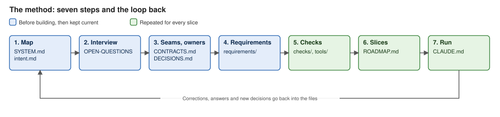

# 2. The method

Six steps. The first four are written once and kept current. The last two repeat for every piece of work.

| Step | Question | Output | Chapter |
|---|---|---|---|
| 1. Map | What exists today, and what is in scope? | [`SYSTEM.md`](../SYSTEM.md) | [3](03-map.md) |
| 2. Seams | Where do the parts meet? | [`CONTRACTS.md`](../CONTRACTS.md) | [4](04-seams-and-owners.md) |
| 3. Owners | Which copy of each fact wins? | [`DECISIONS.md`](../DECISIONS.md) | [4](04-seams-and-owners.md) |
| 4. Done | How do we know a piece of work is finished? | [`ROADMAP.md`](../ROADMAP.md) | [5](05-definition-of-done.md) |
| 5. Slices | In what order do we build? | [`ROADMAP.md`](../ROADMAP.md) | [7](07-slices-and-sessions.md) |
| 6. Run | How is each session run? | [`CLAUDE.md`](../CLAUDE.md), [`OPEN-QUESTIONS.md`](../OPEN-QUESTIONS.md), [`checks/`](../checks) | [6](06-checks.md), [7](07-slices-and-sessions.md) |

## The principles behind the steps

**The specification is the artifact you maintain.** The code is generated from it and can be generated again. In this workspace, the PCM repository states it directly: AI writes all the code, and people maintain the specification.

**Files, not chat.** Anything that must survive the session goes into a file in the repository. Chat is where you think; the repository is where you remember.

**One owner per fact.** Every fact that appears in more than one place has one master copy. The other copies are generated from it or checked against it.

**Every seam gets a check.** A contract between two parts is only real when code verifies it.

**The human decides, the agent builds.** The human answers questions that need judgement, field experience or a change of scope. The agent does everything else, and asks instead of guessing.

**Thin slices, riskiest first.** Build a narrow piece end to end across all the parts, starting with the one that has the most unknowns.

## How the steps feed each other

Text of the diagram, for readers that cannot see it

Colour key: blue = Written once, kept current; green = Repeated for every slice.

Boxes, nested as drawn:
- n1 **1. Map** (Written once, kept current): SYSTEM.md
- n2 **2. Seams** (Written once, kept current): CONTRACTS.md
- n3 **3. Owners** (Written once, kept current): DECISIONS.md
- n4 **4. Done** (Written once, kept current): ROADMAP.md
- n5 **5. Slices** (Repeated for every slice): ROADMAP.md
- n6 **6. Run** (Repeated for every slice): checks, CLAUDE.md

Arrows (from, to, label):
- n1 1. Map --> n2 2. Seams
- n2 2. Seams --> n3 3. Owners
- n3 3. Owners --> n4 4. Done
- n4 4. Done --> n5 5. Slices
- n5 5. Slices --> n6 6. Run
- n6 6. Run --> n1 1. Map: Corrections, answers and new decisions go back into the files

Arrows: `-->` solid, `..>` dashed.

Running a slice always teaches something: a wrong assumption on the map, a seam nobody listed, a question for the human. That goes back into the files before the next slice.

## How long it takes

In this case study, the first version of all the files and two working checks took one long session with the author answering questions. That is small compared with the time the small chats were costing. The files then save that time again at the start of every later session.
