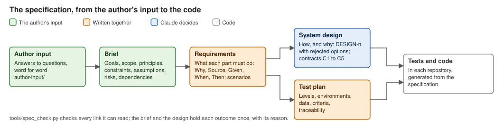

# 10. Test plan and traceability

## Purpose

Each requirement has its test scenarios ([chapter 7](07-requirements-and-acceptance.md)). The test plan shows how all of them fit together: the levels of testing, where each level runs, what data it uses, who or what runs it and when, and what must pass before a milestone counts as done. Without a plan, every scenario is written well and the whole still has gaps: a level nobody runs, data nobody owns, a lab test that waits forever.

The plan is written together. The agent drafts the levels, the environments and the tools. The person adds what only the field knows: realistic data, the cases that break in real estates, and what a demo audience will try first. In this project the plan is [spec/test-plan.md](../spec/test-plan.md).

## Levels

Each level proves something the others cannot. The examples are this project's.

| Level | What it proves | Example |
|---|---|---|
| Unit | One module does its job | PCM's unit tests; the adapter's tests with a fake API |
| Contract | Both sides of a seam agree | The KPI definitions check; the Agent E2 API check |
| Specification | The documents are complete and linked | Every requirement has a source and a test |
| Page | What a user sees works | PCM's page tests in a headless browser |
| Journey | A visitor's path across several pages leads where it should | PCM's rehearsal of its demo script; isvara.io's journey tests on the Vercel preview, from milestone M4 |
| Evaluation | A model's answers are right, cited and safe | Agent E2's graded answer set; isvara.io's citation and injection batteries |
| Lab | The product works on the real system | The adapter's live validation against VCF Operations |
| Acceptance | A milestone's outcome holds, including what no script can judge | The milestone's review page; a demo walk-through |

A level is chosen by what it costs and what it catches. A unit test runs in a second and catches a broken function. The contract check runs in eight seconds and catches a renamed field that both sides' unit tests miss ([chapter 11](11-checks.md)). A lab test needs the author's laptop and catches what no fake can, such as a metric key the real API does not return.

Write down which test each kind of change needs, with its cost and who starts it. A change to the code around a model needs no test of the model; a change to what the model reads does. A test that spends the person's money starts on the person's go. Without such a table, this project's plan once held a US$71 test because a milestone was closing ([chapter 16](16-case-study.md)).

## Environments

Every scenario says where it runs: "anywhere", on any machine with fakes, or "lab", on the real VCF Operations behind the author's VPN. The plan names three environments and what runs in each:

- **Anywhere:** a cloud session or GitHub Actions, with the repositories cloned side by side. The unit tests, page tests, contract checks and specification checks run here. The contract checks run on every pull request of every repository and once a day.
- **With the gateway key:** the same, plus the key of the model gateway. The model evaluations run here, from milestone M3 on, when Agent E2 serves PCM and isvara.io.
- **Lab:** the author's laptop over the VPN, only in milestone M8. Before M8, a session reports each lab test as "not run", lists it in its pull request, and goes on. A test that was not run is never reported as passed.

## Test data

Name the data each level uses, and who keeps it true.

- **Synthetic data with known answers.** PCM's demo customer, ACME Corp, is generated from a fixed specification, so every expected number is known before the code runs. Each regeneration of the code is checked against those numbers.
- **Fakes.** A fake Suite API answers the way VCF Operations does, including the failures: one scenario has it return an error for the second batch of objects, to prove the adapter publishes nothing built from half a read.
- **Boundaries.** A pair on each side of a limit catches an off-by-one: samples 9 and 11 minutes old around the 10-minute limit for stale data.
- **Planted breaks.** Each check has a test that breaks one side on purpose and expects the check to fail ([chapter 11](11-checks.md)).
- **Real data.** The lab supplies what no fake can. A lab test only reads, unless its milestone says otherwise and the person agrees. No test reads customer data.

## A test plan per repository

The workspace's plan sets the rules for every repository. A repository with lab tests also needs a plan of its own, because scenarios spread over many requirements say what to test, and leave out the order, the source of each expected value, and what decides a pass. PCM's live demo had 20 lab scenarios in 35 requirements, with no run order and no walk through the demo itself. The author asked: "Where is the test plan? How do you know it's correct? It's a live validation, so I expect end to end test. See vCommunity Adapter as example of live test."

The adapter's [Live Validation Test Plan](https://github.com/e1-rahabok/PCM-Adapter/blob/main/tools/validate/validate.md) was the model. PCM's [test plan](https://github.com/e1-rahabok/private-cloud-manager/blob/main/spec/test-plan.md) now holds:

- **The levels,** each with its command and where it runs.
- **A run order** of ten steps, from access and the adapter's own validation to the demo end to end. A step whose condition fails stops the run, and every later scenario is reported as not run. The key list is checked before any figure, since a key missing from the lab would fail every figure after it.
- **Safety.** Every lab call only reads, with the read-only account, and no credential is printed or saved in a screenshot.
- **A pass rule.** One line per scenario, PASS, FAIL or NOT RUN, and the run fails when any scenario failed or did not run.
- **The demo end to end** (R-LIVE-036). Every page can pass on its own while the walk through them fails: a step that leads nowhere, or a number that changes between two steps.

The same holds for a product with pages. A page test proves one page; a journey test proves that the pages lead to each other. isvara.io's eight journey requirements, R-JOURNEY-001 to R-JOURNEY-008, each walk one journey of the visitor experience ([chapter 8](08-design.md)) on the Vercel preview. The workspace's [test plan](../spec/test-plan.md) now asks both of every product: a drawing with journey tests where there are pages, and a plan of its own where there are lab tests.

## The oracle

A lab test that checks a value needs a second source for the value the product should show: an oracle. The adapter's validation checks that data exists and is fresh, and says under "Not covered" that it compares no values. PCM's must compare them, because the audience can open the same object in VCF Operations during the demo. Its oracle is a reference script that reads the raw samples from the Suite API with its own calls and computes each figure itself. Its design choices are written like any other ([chapter 8](08-design.md)):

- **It shares no code with PCM's live reader.** A bug in a shared reader would put the same wrong value on both sides, and the comparison would pass. Rejected: calling PCM's reader from the test, which tests PCM against itself; reading the values off the VCF Operations screen, which breaks with each release.
- **It imports the adapter's scoring code.** The adapter computes the KPI that VCF Operations stores, so its code defines the score, and a copy in the test would drift from it.
- **It is tested itself.** An oracle with a bug passes a wrong product, so T-LIVE-024c runs it on a fixed series of 288 samples and expects the values computed by hand.

## Entry and exit

- **A pull request may merge** when every check its repository runs has reported and passed, and its text lists any lab check it could not run.
- **A build milestone may start** when the milestone before it is approved and the repositories it changes run their own tests in continuous integration.
- **A milestone is done** when every scenario of its requirements passes, every listed lab check has run, its review page is current, and the person approves it ([chapter 7](07-requirements-and-acceptance.md)).
- **Failures:** a failing test is a bug to fix or a question for the person. It is never weakened, skipped or deleted to get a pass.
- **Known gaps:** the plan lists what is not tested yet and when it will be. In this project the first gap was that three repositories ran their own tests only in sessions. A page test failed on main and nobody saw it, so in milestone M2, which checked the contracts and cleaned the repositories, each repository gained a workflow that runs its own tests on every pull request. The gap open now is that a scenario names its test in prose, and no check confirms that the test exists. A gap a check cannot fix at once goes into the check's baseline, with an open question, and the baseline may only shrink.

## Traceability

Traceability is the chain from why to proof. The workspace's [specification](../spec/README.md) draws it on its front page, with who writes each link:

Text of the diagram, for readers that cannot see it

Colour key: green = The author's input; orange = Written together; blue = Claude decides; white = Code.

Boxes, nested as drawn:
- n1 **System design** (Claude decides): How, and why: DESIGN-n with rejected options; contracts C1 to C5
- n2 **Author input** (The author's input): Answers to questions, word for word author-input/
- n3 **Brief** (The author's input): Goals, scope, principles, constraints, assumptions, risks, dependencies
- n4 **Requirements** (Written together): What each part must do: Why, Source, Given, When, Then; scenarios
- n5 **Tests and code** (Code): In each repository, generated from the specification
- n6 **Test plan** (Written together): Levels, environments, data, criteria, traceability

Arrows (from, to, label):
- n2 Author input --> n3 Brief
- n3 Brief --> n4 Requirements
- n4 Requirements --> n1 System design
- n4 Requirements --> n6 Test plan
- n1 System design --> n5 Tests and code
- n6 Test plan --> n5 Tests and code

Notes on the diagram:
- tools/spec_check.py checks every link it can read; the brief and the design hold each outcome once, with its reason.

Arrows: `-->` solid, `..>` dashed.

Each link is an ID, so a script can follow it. The workspace's own rule on tests shows every link:

- a principle and a goal in the brief: PRINCIPLE-6, "The specification is what people maintain", and GOAL-3, "Value without the author";
- the requirement: R-WS-003, "Every requirement is tested, and every test has a requirement", whose Source line names DESIGN-8;
- the design choice: DESIGN-8, "Traceability from the author's input to the code", whose Serves line names PRINCIPLE-6, GOAL-3 and R-WS-003;
- the test scenario that proves it: T-WS-003a, in which a requirement without a Why line, a requirement without a scenario, a scenario without a requirement, a duplicate ID or a Source that names no existing ID fails the check;
- the test code the scenario names: [tools/spec_check.py](../tools/spec_check.py);
- the result of the last run, in the pull request's checks.

With the chain in place, three questions can be answered from the files alone. Why does this code exist? Follow it up. What breaks if this goal changes? Follow it down. Is the milestone done? Count the results at the bottom.

Most of the chain is checked by script in this project today ([test plan](../spec/test-plan.md), section Traceability). The specification check fails a requirement with no Why line, no scenario or a Source that names no existing ID, a scenario with no requirement, and a brief item or design choice that names an ID that does not exist. [tools/milestone_review.py](../tools/milestone_review.py) fails a requirement that sits in no milestone or in two, and a lab scenario outside the lab milestone. While the child repositories moved to the new form, the check listed their requirements still without a Why line, 170 of 202, without failing them. Once every repository had moved, a missing Why line fails anywhere, and so does a Source that names a WD- ID from the retired decision log.

The links nearest the code are the newest. 131 of the 309 scenarios name a test that is still to write. That is expected before their milestones are built. At the end of a milestone, a script should confirm that each named test exists and passed; until then, a scenario that names an unwritten test reads like coverage in a list.

## Division of work

- The agent drafts the levels, the environments, the tools and the traceability checks, and keeps the plan in step with the requirements.
- The person adds realistic data and the failure cases the field knows, and agrees which scenarios stay manual.
- Both read the result at the end of each milestone.

## In VMware terms

This is the test plan of a design, signed off before the build: what is tested, how, in which environment, and what counts as a pass. The traceability chain is the matrix that maps each requirement to its design decision and its test.

## Exercise

Take one requirement of your own and write its chain: the goal it serves, the design choice that meets it, two scenarios at different levels, and the name of each test. Mark the links that no script checks.
